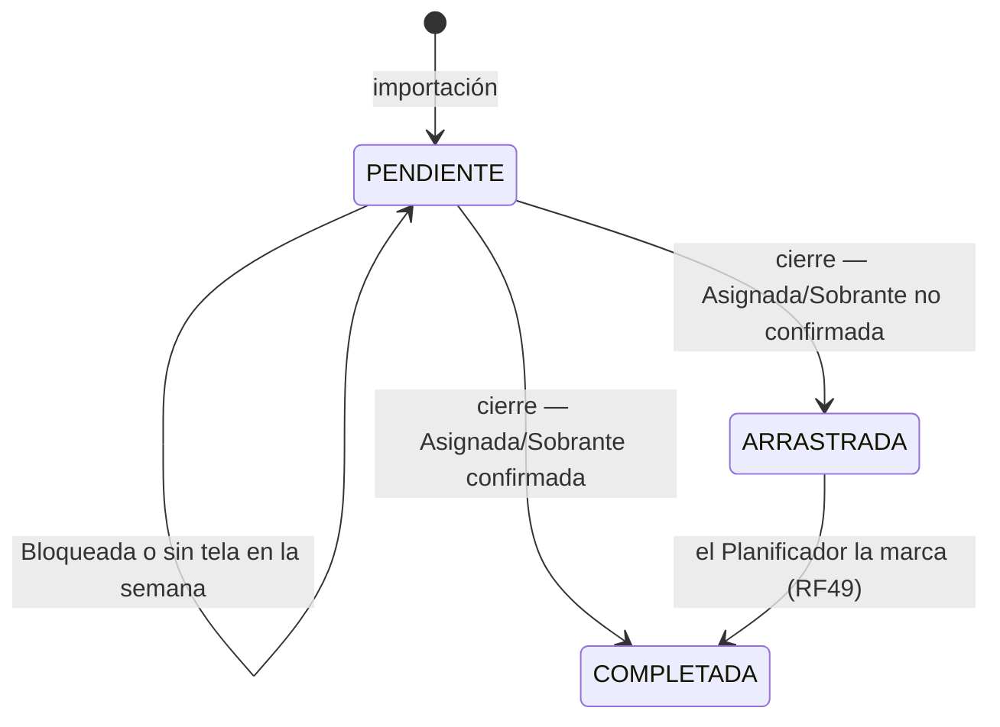

# SPATS — Contexto del sistema para Claude Code

> **Qué es este documento.** Reúne todo lo definido para SPATS (Sistema de Planificación de Abastecimiento de Tintorería): alcance, reglas de negocio, estados, lógica del algoritmo ganador, base de datos, arquitectura C4, requisitos funcionales e historias de usuario.
>
> **Cómo usarlo.** El código **no se crea desde este documento**. El proyecto que acompaña a este archivo ya contiene el código (backend, frontend y el módulo del algoritmo). Este documento sirve para **entender** lo que ese código debe hacer y por qué. Ante una diferencia entre el código y este documento, **pregunta antes de cambiar nada**.
>
> Versión: 25 de octubre de 2026, actualizada el 2 de noviembre de 2026 con las decisiones confirmadas D-05 a D-37 (detalle en `CONTROL_DE_VERSIONES/DECISIONES.md`). Fuentes: R3.1 Catálogo de requisitos, R3.2 Especificación de requisitos, R3.3 Modelo de base de datos (con los cambios de esta fecha), R3.6 Arquitectura C4, R2.2/R2.3 (algoritmo) y decisiones confirmadas por la autora.

---

## 1. Reglas de trabajo para el agente

1. **El código existente manda.** Trabaja sobre el código del proyecto. No lo reemplaces, no lo reestructures y no lo reorganices por tu cuenta. Corrige solo lo que se pida.
2. **No cambies la lógica del algoritmo.** El algoritmo se tomó de la literatura (Fidanova et al., 2025) y se calibró en la experimentación del R2.2. No agregues búsqueda local, reparaciones, heurísticas nuevas ni parámetros nuevos. Si algo del sistema exige tocarlo (por ejemplo, la re-planificación), propón el cambio y espera confirmación.
3. **No inventes.** Si una regla no está en este documento ni en el código, márcala como vacío y pregunta. La sección 13 lista los vacíos conocidos.
4. **Todo resultado se guarda en la base de datos.** El backend ejecuta el algoritmo y guarda todo lo que produce. Las pantallas leen lo guardado y no recalculan indicadores, saldos ni clasificaciones.
5. **Términos obligatorios:**
   - El sistema hace **asignación de partidas a máquinas de tintorería**. No digas "programación de tintorería" (implica horas) ni "planificación de tintorería" sin precisar.
   - Nunca uses la expresión **"tiempo real"**: ni en código, ni en textos, ni en mensajes de la interfaz.
   - Para lo que hace el sistema con la información, di **"cruzar información"**, no "integrar".
6. **Identificadores de dominio en español** (Partida, Maquina, sobrante, bolsa…), en el backend y en el frontend.
7. **Idioma:** toda la interfaz, los mensajes y los textos en español (RNF01).

---

## 2. Qué es SPATS

El jefe de planeamiento (único usuario operativo) asigna cada semana las **partidas** a las **máquinas de tintorería**. Hoy lo hace a mano en Excel y no puede comprobar que todas las máquinas queden equilibradas día por día.

SPATS recibe la **proyección de tejeduría** (qué kilos de cada artículo se tejerán cada día), decide **qué partidas se conforman** con esa tela y **a qué máquina de su barca va cada una**, y construye un **calendario de 7 días por máquina** que deja las máquinas lo más equilibradas posible. Para eso usa un algoritmo de **colonia de hormigas (ACO)**.

El calendario es una **cola de partidas candidatas por máquina y por día**. No asigna horas de inicio ni de fin, y el jefe de planeamiento conserva la decisión sobre la ejecución real.

### 2.1 Dentro del alcance

- Autenticación con dos perfiles (Planificador y Consulta) y modos de interacción Guiado y Experto.
- Carga de pedidos, artículos, partidas y proyección de tejeduría desde hojas de cálculo. La carga es acumulable: el planificador sube cada cierto tiempo lo que corresponde al mes.
- Configuración de máquinas e indisponibilidades.
- Generación de la planificación semanal con el ACO.
- Calendario, clasificación de partidas (Asignada, Sobrante, Bloqueada), indicadores de lavado, desviaciones y recomendaciones. Las recomendaciones de tejeduría (RF30) tienen la regla aprobada y se implementan en un incremento posterior (sección 13).
- Cierre de semana, partidas arrastradas e incidencias con re-planificación. La re-planificación desde el día actual, con propuesta, confirmación y descarte, **está implementada** (sección 9.5).
- Historial de versiones y trazabilidad.

### 2.2 Fuera del alcance (no construir)

- **Escenarios** (simulaciones aisladas) y **Reportes** para laboratorio o programación. Quedaron fuera; no tienen tablas ni componentes en el C4.
- **Edición manual del calendario.** No hay arrastrar y soltar ni mover partidas a mano. El calendario solo cambia al generar o re-planificar.
- **Receta.** Su estado nunca filtra ni bloquea la planificación.
- **Conexión automática con otros sistemas.** Toda la información entra por carga manual de archivos o por registro en pantalla.
- **Horas.** No hay línea de tiempo en horas ni horario de inicio o fin por partida.
- **Detección automática de incidencias.** Las registra el planificador.

---

## 3. Glosario

| Término | Definición en SPATS |
|---|---|
| Partida | Unidad de trabajo que se tiñe de una sola vez en una máquina. Pertenece a un pedido, tiene un color, un peso y una barca, y requiere tela de uno o más artículos (componentes). |
| Componente | Tela que la partida necesita de un artículo: **tela principal** o **complemento** (rib, cuello, puño…). Cada uno con su peso requerido. |
| Artículo | Tipo de tela que se teje. |
| Barca | Texto como `400 C` o `500 B`: capacidad de la máquina (kg) y tipo de color (**C** color, **B** blanco). Una partida puede ir a **cualquier máquina con su misma barca**. |
| Clasificación de color | El tipo C o B. Decide a qué máquinas puede ir la partida (`color.clasificacion_color`, `maquina_tintoreria.clasificacion_color`). |
| Tonalidad | Tono del color: `BLANCO < CLARO < MEDIO < OSCURO`. Sirve para detectar lavados **dentro de una misma máquina** (`color.tonalidad`). |
| Lavado | Hace falta cuando, en una misma máquina, una partida va después de otra de tonalidad más oscura. |
| Proyección de tejeduría | Kilos de cada pedido-artículo que tejeduría tejerá cada día. Se registra cada semana. |
| Bolsa (de un artículo) | Tela **cruda** disponible de un artículo. Hay una bolsa por artículo y su clave es `articulo.codigo` (D-25). Reúne lo tejido para **cualquier pedido** y **no pertenece a ninguna partida**. Su saldo pasa de un día a otro y de una semana a la siguiente. |
| Conformar una partida | Asignarle de una sola vez toda la tela que requiere (principal y complementos). Nunca se llena a medias. |
| Partida candidata | Partida en estado `PENDIENTE` que puede evaluarse en la semana. |
| Objetivo semanal | Partidas que debe recibir cada máquina en la semana. Lo configura el planificador por máquina; la referencia es 16. |
| Desviación de carga | Diferencia entre las partidas de una máquina y su objetivo. |
| Planificación vigente | Única versión activa de la planificación de una semana. |
| D | Día actual al re-planificar. Se conserva hasta D-1 y se reevalúa desde D. |

---

## 4. Usuarios

| Perfil | Quién | Permisos |
|---|---|---|
| Planificador | Jefe de planeamiento | Todo: cargar, modificar, configurar, generar, cerrar, registrar incidencias y re-planificar. |
| Consulta | Programador y otras cuentas | Solo lectura de la planificación vigente, su distribución y la información permitida. Nunca crea, modifica ni elimina. Varias cuentas, todas con la misma visibilidad. |

- Cada cuenta tiene su propio usuario y contraseña. La sesión se cierra a mano o por inactividad.
- **Modo Guiado y modo Experto** (`usuario.modo_interaccion`): son solo de presentación. Cambian cómo se muestra el flujo, no las funciones ni los permisos (RF07, HU-03). El modo guiado existe para que otra persona pueda planificar si falta el jefe de planeamiento.

---

## 5. Ciclo de una semana

```
Proyección de tejeduría (días de TEJIDO):  Sáb(sem. anterior) Lun  Mar  Mié  Jue  Vie        (domingo en blanco)
                                                   │            │    │    │    │    │
                                                   └──► Lun     └──► └──► └──► └──► └──► Sáb
Calendario de tintorería (días de ABASTECIMIENTO): Lun  Mar  Mié  Jue  Vie  Sáb  Dom
```

- **Semana de planificación:** lunes a domingo (7 días). `semana.fecha_inicio` siempre es lunes y `fecha_fin`, domingo.
- **Ventana de la proyección:** para evaluar la semana se toma lo tejido desde el **sábado anterior** hasta el **viernes** de esa semana (6 días de tejido). Es un filtro sobre `detalle_proyeccion_tejeduria.fecha_proyectada`, no una columna. Si los días de la proyección cambian, el algoritmo no debe verse afectado.
- **Regla de disponibilidad:** lo tejido de lunes a viernes queda disponible en tintorería **al día siguiente**; lo tejido el **sábado**, el **lunes**. El domingo no llega tela nueva, pero **sí recibe partidas** acumuladas de días anteriores.
- La tela de 6 días de tejido debe alcanzar para abastecer los 7 días de tintorería.
- **El domingo es día de abastecimiento** del calendario.

> El R3.1 y el R3.2 todavía dicen que el día operativo es de lunes a sábado. Esa redacción se va a corregir; **manda lo de esta sección** (7 días, domingo incluido).

---

## 6. Estados y clasificaciones

Hay **tres campos distintos**; no los mezcles.

### 6.1 `partida.estado_partida` — estado general en el tiempo

| Estado | Significado | ¿Puede entrar a una planificación? |
|---|---|---|
| `PENDIENTE` | No se ha teñido. Incluye las que nunca recibieron tela y las Bloqueadas. | **Sí.** Es el único estado candidato. |
| `ARRASTRADA` | Estuvo en una planificación cerrada como Asignada o Sobrante y no se confirmó como completada. Ya tenía su tela separada. | **No.** Solo se muestra (RF45–RF49). No cuenta en objetivos, desviaciones ni recomendaciones. |
| `COMPLETADA` | El planificador confirmó que se completó. | No. |

- Al importar, toda partida nueva entra como `PENDIENTE`.
- Una `ARRASTRADA` pasa a `COMPLETADA` solo cuando el planificador la marca a mano (RF49). Nunca vuelve a `PENDIENTE`.
- Cuando todas las partidas de un pedido están `COMPLETADA`, el pedido se completa automáticamente (decisión confirmada; `pedido.estado` pasa de `PENDIENTE` a `COMPLETADO`, D-20).

### 6.2 `planificacion_partida.clasificacion_resultado` — resultado dentro de una versión

| Clasificación | Cuándo | Máquina y día |
|---|---|---|
| `ASIGNADA` | Se conformó y quedó dentro del objetivo semanal de su máquina. | Con máquina y día. |
| `SOBRANTE` | Se conformó, pero excede el objetivo semanal de su máquina o ya no hay espacio en los días que le quedan. **Igual aparece en el calendario**, en su primer día disponible, marcada como Sobrante. | Con máquina y día. |
| `BLOQUEADA` | La bolsa de al menos uno de sus artículos tuvo kilos en la semana, pero no alcanzaron para completar toda la partida (principal o complemento). **No consume tela**: la bolsa no se le reserva. | **Sin** máquina y sin día. |

- Una partida `PENDIENTE` cuyos artículos no tuvieron **ningún kilo** en la semana **no se registra** en la planificación: simplemente sigue `PENDIENTE`.
- La regla de "al menos uno de sus artículos" sale de la HU-09 C5: si la tela principal alcanza y el complemento no, la partida es Bloqueada.
- La base de datos obliga a que una `BLOQUEADA` no tenga máquina y a que una `ASIGNADA` o `SOBRANTE` sí la tenga (`ck_planpart_bloqueada_sin_maquina`).

### 6.3 `planificacion_partida.estado_confirmacion_cierre` — resultado al cerrar la semana

| Valor | Significado |
|---|---|
| `NULL` | La semana sigue abierta. |
| `COMPLETADA` | El planificador confirmó que esa partida se tiñó. |
| `ARRASTRADA` | Tenía su tela separada pero no se tiñó. |

Al cerrar (HU-15, RF42–RF44):

- Las Asignadas y Sobrantes confirmadas pasan a `COMPLETADA`; las no confirmadas, a `ARRASTRADA`.
- Las **Bloqueadas no cambian**: siguen `PENDIENTE` y se vuelven a evaluar la semana siguiente.
- Si no se confirma ninguna, todas las Asignadas y Sobrantes pasan a `ARRASTRADA`.



> El código del algoritmo usa `PENDIENTE / PLANIFICADA / COMPLETADA / ARRASTRADA` (`spats.algoritmo.entrada.EstadoPartida`) y solo evalúa las `PENDIENTE`. `PLANIFICADA` solo existe para encadenar semanas en las pruebas con Excel. En el sistema, el backend envía al algoritmo **solo partidas candidatas** con `EstadoPartida.PENDIENTE` y guarda los estados de la base (`PENDIENTE / ARRASTRADA / COMPLETADA`).

### 6.4 `planificacion_semanal.estado` — estado de una versión de la planificación

| Estado | Significado | ¿Vigente? |
|---|---|---|
| `ABIERTA` | Versión vigente de una semana en curso. | Sí |
| `CERRADA` | Versión vigente de una semana ya cerrada (RF42). | Sí |
| `REEMPLAZADA` | Dejó de ser vigente porque se generó otra versión de la semana (D-14) o se confirmó una re-planificación. Se conserva en el historial. | No |
| `INVALIDADA` | Dejó de ser vigente porque cambió la proyección de la semana (D-06) o se modificó una partida Asignada o Sobrante de esa versión (D-24). Se conserva en el historial. | No |
| `PROPUESTA` | Re-planificación pendiente de confirmar (D-13b). No cuenta como versión del historial; si se descarta, se elimina (D-26). | No |

---

## 7. Reglas de negocio

**Tela y conformación**

- **RN-01 — La tela se acumula por artículo.** Lo tejido para cualquier pedido entra a la bolsa de su artículo, y esa bolsa abastece partidas de cualquier pedido. La proyección viene por pedido-artículo (`detalle_pedido`), pero el algoritmo la suma por artículo.
- **RN-02 — Nunca a medias.** Una partida recibe tela solo cuando la bolsa alcanza para **todos** sus componentes a la vez. Los kilos que no alcanzan quedan en la bolsa del artículo.
- **RN-03 — El saldo pasa al día y a la semana siguiente.** El saldo final del domingo, en la versión vigente, es el saldo inicial de la semana siguiente.
- **RN-04 — Prioridad por fecha de entrega.** Cuando la tela permite completar varias partidas, primero se consideran las del pedido con fecha de entrega más próxima. Entre partidas con la **misma fecha**, decide el algoritmo, que evalúa en conjunto qué partida conformar y a qué máquina va.
- **RN-05 — Se conforma todo lo que se pueda.** Cada día se repite la conformación hasta que ninguna partida pendiente pueda completarse. La fecha de entrega solo cambia el resultado cuando la tela de un artículo no alcanza para todas las partidas que la piden.

**Máquinas**

- **RN-06 — Compatibilidad por barca.** Una partida solo va a una máquina con su misma barca. La barca ya incluye la capacidad y la clasificación de color (HU-11 C8 y C9).
- **RN-07 — Objetivo semanal.** Configurable por máquina (16 de referencia). Por cada día indisponible de la máquina en la semana, el objetivo baja 2 partidas (con un día indisponible, 16 → 14).
- **RN-08 — Reparto diario en partidas completas.** En los días hábiles de la máquina: mínimo diario = ⌊objetivo / días hábiles⌋ y máximo diario = ⌈objetivo / días hábiles⌉. Con 16 en 7 días quedan 2 y 3; con 14 en 6 días, 2 y 3. Nunca fracciones.
- **RN-09 — Equilibrio semanal y diario son distintos.** Una máquina que llega a su objetivo pero concentra la carga en pocos días es un mal resultado. La función objetivo castiga los dos.
- **RN-10 — Si la tela no alcanza, igual se equilibra.** Si la proyección no cubre el objetivo de todas las máquinas, deben quedar equilibradas entre sí. El algoritmo siempre devuelve una asignación factible (RF28).
- **RN-11 — Indisponibilidad.** Una máquina no recibe partidas regulares en sus días indisponibles.

**Calendario**

- **RN-12 — Disponibilidad temporal.** Una partida no se ubica antes de su `fecha_disponible`, el día en que su tela completa queda disponible en tintorería (sección 5).
- **RN-13 — Llenado día a día.** Las partidas de cada máquina se ordenan por fecha de entrega, día disponible y orden de llegada. Cada día hábil recibe el máximo diario mientras haga falta para llegar al objetivo, y el mínimo en los demás (con 16: 3, 3, 2, 2, 2, 2, 2). Lo que no entra un día pasa al siguiente.
- **RN-14 — Sobrantes en el calendario.** Las partidas que exceden el objetivo, o que llegan cuando los días restantes ya están llenos, se muestran en su **primer día disponible** como Sobrante.
- **RN-15 — Orden dentro del día.** En cada máquina y día van primero las regulares y luego las Sobrantes, cada grupo en orden de llegada. Ese orden se guarda en `orden_secuencia` y es el que se usa para detectar lavados.
- **RN-16 — Lavado.** Se marca `requiere_lavado_previo` cuando la partida anterior en la misma máquina tiene una tonalidad más oscura. La comparación sigue la secuencia completa de la máquina durante la semana.

**Ciclo semanal**

- **RN-17 — Solo se muestra la mejor solución** (RF37). El algoritmo no expone las alternativas que evaluó.
- **RN-18 — Arrastradas fuera.** No participan en la generación, la re-planificación, los objetivos, las desviaciones ni las recomendaciones (RF47, RF48).
- **RN-19 — Fallo sin efectos.** Si el algoritmo falla, la planificación vigente queda intacta y no se guarda ninguna versión parcial (RNF06, HU-11 C15, HU-18 C10). Todo el guardado de una corrida va en una sola transacción.
- **RN-20 — Tiempo.** El resultado debe estar listo en 60 segundos como máximo (RNF03). En la experimentación, una corrida promedió 0.73 s.
- **RN-21 — Confirmación.** Toda acción que modifica la planificación vigente pide confirmación (RF59).
- **RN-22 — Una sola vigente por semana** (RF58). La base de datos lo garantiza con `vigente_semana`.
- **RN-23 — Datos completos.** No se ejecuta el algoritmo si faltan datos de la semana (HU-11 C13).

**Incidencias y re-planificación**

- **RN-24 — Tres tipos de incidencia**, cada uno con su entidad afectada:
  - `INCIDENCIA_MAQUINA` → máquina, con fecha y hora prevista de disponibilidad.
  - `PROBLEMA_COMPLEMENTO` → partida, con fecha y hora prevista de disponibilidad.
  - `CAMBIO_PRIORIDAD` → pedido, con `nueva_fecha_entrega` y sin fecha de disponibilidad.

  Se pueden acumular varias antes de una sola re-planificación.
- **RN-25 — Re-planificación desde D.** Conserva sin cambios las asignaciones hasta D-1 y reevalúa la distribución desde el día actual D, considerando juntas todas las incidencias seleccionadas. Cada re-planificación crea una versión nueva (`tipo_generacion = 'REPLANIFICACION'`) vinculada a sus incidencias en `planificacion_incidencia`. Si no encuentra una alternativa con menor desviación que la vigente, conserva la vigente y muestra una alerta (RF55). El detalle está en la sección 9.5.

**Vigencia y encadenamiento de semanas** (decisiones confirmadas)

- **D-06 — Cambio de proyección.** Cambiar la proyección de una semana con planificación vigente abierta exige confirmación. La vigente pasa a `INVALIDADA`, se conserva en el historial y el calendario queda en blanco hasta volver a generar. Se puede volver a una versión anterior de la proyección.
- **D-14 y D-15 — Volver a generar.** Volver a generar una semana crea una versión nueva, que pasa a vigente; la anterior queda `REEMPLAZADA`. La primera semana, sin versión vigente anterior, empieza con stock 0.
- **D-16 — Planificar sin cerrar la anterior.** Se puede planificar N+1 sin haber cerrado N. Las partidas Asignadas o Sobrantes de la vigente abierta de N no se envían al planificar N+1, porque su tela ya se consumió.
- **D-19 — Marca de N+1.** Cualquier cambio en la vigente de N (otra versión, invalidación por la proyección o por una partida, o re-planificación confirmada) deja la vigente abierta de N+1 con `stock_desactualizado = TRUE`. La marca se guarda en la base y la pantalla sugiere volver a generarla. Cerrar N **no** la activa, porque cerrar no cambia la vigente.
- **D-19 — Cierre en orden.** No se cierra N+1 mientras N tenga planificación vigente abierta.
- **D-22 — Generación síncrona.** La solicitud espera el resultado, con un tope de 60 s. No se permiten dos generaciones simultáneas de la misma semana.

**Datos**

- **D-23 — Componente principal.** Al importar, cada partida debe tener al menos un componente `PRINCIPAL`.
- **D-24 — Modificación manual de partidas.** Solo se modifican las partidas `PENDIENTE`; las arrastradas y completadas conservan sus datos. Si se modifica una partida que está Asignada o Sobrante en la vigente abierta, se pide confirmación, esa vigente pasa a `INVALIDADA` y se marca N+1 (como D-06).
- **D-25 — Código de artículo.** Al importar, solo se quita un prefijo numérico entre paréntesis al inicio del código (por ejemplo, `(313811)TW2021AA00P03` → `TW2021AA00P03`), y el aviso muestra el código original y el limpio.

---

## 8. El algoritmo ganador: colonia de hormigas (ACO)

### 8.1 Origen y selección

- En el R2.2 se compararon un algoritmo genético (Campo et al., 2022) y una colonia de hormigas (Fidanova et al., 2025). Una regla voraz, que reproduce el criterio actual del planificador, sirvió solo como línea base.
- Se usaron 12 instancias (3 semanas reales de setiembre × 4 condiciones) con 20 corridas por algoritmo y 6000 evaluaciones cada una.
- El ACO fue significativamente mejor en las 12 instancias: RPD de 0.89 % frente a 10.83 %, y una desviación estándar entre corridas 84.7 % menor.
- El código del R2.3 (`spats-algoritmo`) contiene **solo el ACO**, sin la experimentación.

### 8.2 Qué decide

El algoritmo toma **dos decisiones a la vez**, evaluadas sobre la semana completa:

1. **Qué partida conformar** cuando la tela permite completar varias con la misma fecha de entrega.
2. **A qué máquina de su barca va** cada partida conformada.

El día **no lo decide el algoritmo**: lo fija una regla común de llenado del calendario (RN-13 y RN-14).

### 8.3 Paso a paso (lo que hace el código)

**1. Construir la instancia** (`nucleo.ConstructorInstancia`)

- **Días:** de lunes a domingo, a partir de `ParametrosPlanificacion.fechaInicioSemana`, que debe ser lunes.
- **Máquinas:** días hábiles (los días indisponibles se quitan), objetivo efectivo (RN-07) y mínimo y máximo diario (RN-08).
- **Bolsas:** una por artículo. Parten con el stock inicial y reciben cada día lo que queda disponible según `RegistroProyeccion.fechaDisponible()` (regla de la sección 5).
- **Partidas:** se toman las `PENDIENTE`, ordenadas por orden de registro. Quedan fuera:
  - las que no tienen ninguna máquina de su barca (motivo `SIN_MAQUINA`);
  - las que tienen algún componente que no cabe en la tela total de la semana, es decir, stock inicial más llegadas (motivo `SIN_TELA`).

  El resto son candidatas.

**2. Simular la semana día a día** (`nucleo.SimuladorConformacion`). Cada hormiga construye una semana completa:

```
para cada día d = lunes..domingo:
    sumar a cada bolsa la tela que queda disponible ese día
    repetir:
        C ← partidas pendientes cuya tela alcanza para TODOS sus componentes
        si C está vacío: salir (los kilos quedan en la bolsa)
        C ← solo las de fecha de entrega más próxima
        p ← si |C| = 1, esa; si no, la elige la hormiga
        descontar de las bolsas toda la tela de p
        m ← si su barca tiene una sola máquina, esa; si no, la elige la hormiga
        registrar diaConformacion[p] = d, orden[p] = k, maquina[p] = m
stockFinal ← saldo de cada bolsa
```

**3. Construir el calendario** (`nucleo.ConstructorCalendario`). Por máquina:

- **Orden:** fecha de entrega, día de conformación y orden de llegada.
- **Día disponible:** el primer día hábil desde `diaConformacion`.
- **Cuota diaria:** el máximo diario si `restante − máximo ≥ mínimo × días hábiles que quedan`; si no, el mínimo.
- **Llenado:** cada día se ubican hasta la cuota las partidas ya disponibles; las que no entran pasan al día siguiente.
- **Al final:** las que quedan sin ubicar son Sobrantes y van a su primer día disponible.

**4. Función objetivo** (`nucleo.FuncionObjetivo`). Se minimiza:

```
F = α·E_S + β·E_D + γ·Λ        con α = 1, β = 1, γ = 0.25
E_S = Σ_m (partidas de m, incluidas Sobrantes − objetivo_m)²
E_D = Σ_m Σ_días hábiles [ max(0, mínimo − regulares del día)² + max(0, regulares del día − máximo)² ]
Λ   = número de pasos a una tonalidad más clara entre partidas consecutivas de la misma máquina
```

- Los cuadrados hacen que un desbalance grande pese más que varios pequeños.
- Los lavados pesan 0.25 para que el equilibrio sea lo prioritario.

**5. Colonia de hormigas** (`aco.ColoniaHormigas`)

- **Nodo:** cada par partida–máquina, con feromona inicial τ0 = 0.5.
- **Atractivo de un nodo:** `τ[p][m]^a · η[m]^b`, con `η[m] = objetivo[m] / (carga[m] + 1)`. Favorece las máquinas menos cargadas.
- **Elegir la partida:** por ruleta, con peso igual a la suma del atractivo sobre las máquinas de su barca.
- **Elegir la máquina:** por ruleta, con peso igual al atractivo de cada máquina.
- **Al final de cada iteración:** se evapora la feromona (`τ ← ρ·τ`) y la mejor hormiga de la iteración deposita `(1 − ρ) / (1 + F)` en los nodos que usó.
- **Parada:** al agotar las evaluaciones o el tiempo máximo. Se devuelve la mejor semana encontrada.

**6. Validar** (`nucleo.Validador`). Rehace el consumo de tela y revisa:

- disponibilidad de tela;
- prioridad por fecha;
- inclusión (no quedó sin conformar nada que la tela permitiera);
- barca;
- disponibilidad temporal;
- días indisponibles;
- máximo diario y objetivo;
- Sobrantes solo cuando ya no hay espacio.

Una solución es factible si la lista de incumplimientos está vacía (`Indicadores.factible()`).

### 8.4 Parámetros (quedan en el código, no en la base)

| Parámetro | Valor | Clase |
|---|---|---|
| Hormigas por iteración | 20 | `ParametrosACO` |
| ρ (feromona conservada) | 0.90 | `ParametrosACO` |
| τ0 (feromona inicial) | 0.50 | `ParametrosACO` |
| a (peso de la feromona) | 1 | `ParametrosACO` |
| b (peso de la heurística) | 2 | `ParametrosACO` |
| Evaluaciones por corrida | 6000 | `ParametrosACO` |
| Tiempo máximo | 60 s | `ParametrosACO` |
| Semilla | 1 | `ParametrosACO` |
| α, β, γ | 1, 1, 0.25 | `ParametrosPlanificacion` |
| Reducción del objetivo por día indisponible | 2 | `ParametrosPlanificacion` |
| Días de la semana | 7 | `ParametrosPlanificacion` |

El **objetivo semanal de cada máquina** sí está en la base (`maquina_tintoreria.objetivo_semanal`), porque lo configura el planificador.

### 8.5 Estructura del módulo `spats-algoritmo`

El módulo es Java puro, sin dependencias externas (JUnit solo para pruebas). Debe seguir **sin Spring** dentro del backend.

| Paquete | Contenido |
|---|---|
| `spats.algoritmo` | `PlanificadorSemanal`: punto de entrada, `planificar(DatosSemana, ParametrosACO) → ResultadoPlanificacion`; `evaluar(DatosSemana, List<AsignacionPartida>) → Indicadores` calcula la F de unas decisiones dadas (RF55). La regla voraz `ReglaReferencia` está en `src/test` y solo sirve para pruebas. |
| `spats.algoritmo.entrada` | Contrato de entrada: `DatosSemana`, `ParametrosPlanificacion`, `Maquina`, `Indisponibilidad`, `Pedido`, `Partida`, `Componente`, `RegistroProyeccion`, `StockArticulo`, `Tonalidad`, `EstadoPartida`. Para la re-planificación: `Replanificacion` (día D, `AsignacionFija`, `ConformacionConservada`, `DisponibilidadPartida`), componente opcional de `DatosSemana`. |
| `spats.algoritmo.nucleo` | Modelo común: `ConstructorInstancia`, `InstanciaSemana`, `SimuladorConformacion`, `EstrategiaDecision`, `ConstructorCalendario`, `Calendario`, `FuncionObjetivo`, `Evaluacion`, `Solucion`, `Validador`, `PartidaExcluida` (motivos `SIN_MAQUINA`, `SIN_TELA` y, en la re-planificación, `SIN_DIA_DISPONIBLE` y `TELA_DEVUELTA`). |
| `spats.algoritmo.aco` | `ColoniaHormigas` (con `Hormiga`), `ParametrosACO`, `ResultadoBusqueda`. |
| `spats.algoritmo.salida` | Contrato de salida: `ResultadoPlanificacion`, `AsignacionPartida`, `EstadoAsignacion` (`ASIGNADA`, `SOBRANTE`), `ResumenMaquina`, `PartidaBloqueada` (partida no conformada y su motivo; incluye `TELA_PRIORIZADA`), `Indicadores`, `EstadoSiguiente`. |
| `spats.algoritmo.excel` | Adaptador de **prueba** que lee y escribe Excel. En el sistema, los datos vienen de la base y este paquete no se usa. |

La ampliación del contrato para la re-planificación se aprobó el 01/11; la búsqueda del ACO y la función objetivo **no cambiaron**. Con D = lunes y sin incidencias, la re-planificación da el mismo resultado que la generación inicial.

La **prueba de regresión** consiste en que, con los Excel generados en R y la misma semilla, el motor dentro del backend dé el mismo F que el código del R2.3, sin incumplimientos del validador.

---

## 9. Conexión entre el algoritmo y la base de datos

El componente **Planificación semanal** del backend coordina: lee de la base, arma `DatosSemana`, llama a `PlanificadorSemanal.planificar`, y guarda el resultado completo en **una transacción**. El algoritmo no conoce la base.

### 9.1 Tablas (PostgreSQL, base `tintoreria`, 22 tablas)

| Grupo | Tablas |
|---|---|
| Acceso | `rol`, `usuario`, `carga_datos`, `bitacora_auditoria` |
| Demanda | `cliente`, `pedido`, `articulo`, `detalle_pedido`, `color` |
| Partidas | `partida`, `partida_componente` |
| Abastecimiento | `semana`, `proyeccion_tejeduria`, `detalle_proyeccion_tejeduria` |
| Máquinas | `maquina_tintoreria`, `indisponibilidad_maquina` |
| Resultado | `planificacion_semanal`, `planificacion_partida`, `planificacion_maquina`, `bolsa_articulo` |
| Incidencias | `incidencia`, `planificacion_incidencia` |

**Dominios fijados en la base:**

| Columna | Valores |
|---|---|
| `usuario.modo_interaccion` | `GUIADO`, `EXPERTO` |
| `carga_datos.tipo_dato` | `PEDIDOS`, `PARTIDAS`, `PROYECCION_TEJEDURIA` |
| `color.tonalidad` | `BLANCO`, `CLARO`, `MEDIO`, `OSCURO` |
| `partida.estado_partida` | `PENDIENTE`, `ARRASTRADA`, `COMPLETADA` |
| `partida_componente.tipo_componente` | `PRINCIPAL`, `COMPLEMENTO` |
| `planificacion_semanal.tipo_generacion` | `INICIAL`, `REPLANIFICACION` |
| `planificacion_partida.clasificacion_resultado` | `ASIGNADA`, `SOBRANTE`, `BLOQUEADA` |
| `planificacion_partida.estado_confirmacion_cierre` | `COMPLETADA`, `ARRASTRADA`, o `NULL` |
| `incidencia.tipo_incidencia` | `INCIDENCIA_MAQUINA`, `PROBLEMA_COMPLEMENTO`, `CAMBIO_PRIORIDAD` |
| `color.clasificacion_color`, `maquina_tintoreria.clasificacion_color` | `C`, `B` (D-07) |
| `indisponibilidad_maquina.tipo_indisponibilidad` | `INDISPONIBLE`, `MANTENIMIENTO` (D-21) |
| `usuario.estado` | `ACTIVO`, `INACTIVO` (D-20) |
| `pedido.estado` | `PENDIENTE`, `COMPLETADO` (D-20) |
| `planificacion_semanal.estado` | `ABIERTA`, `CERRADA`, `REEMPLAZADA`, `INVALIDADA`, `PROPUESTA` (D-20, sección 6.4) |
| `proyeccion_tejeduria.estado` | `VIGENTE`, `REEMPLAZADA` (D-20) |
| `maquina_tintoreria.estado` | `OPERATIVA`, `INDISPONIBLE`, `EN_MANTENIMIENTO` (D-20) |
| `incidencia.estado` | `PENDIENTE`, `CONSIDERADA` (D-20) |
| `bitacora_auditoria.tipo_operacion` | `INICIAR_SESION`, `IMPORTAR`, `CREAR`, `MODIFICAR`, `GENERAR`, `INVALIDAR`, `CERRAR`, `COMPLETAR`, `REGISTRAR`, `RESTAURAR`, `PROPONER`, `CONFIRMAR`, `DESCARTAR` (D-20, D-37) |

**Columnas agregadas al modelo del R3.3:**

- `bitacora_auditoria.id_entidad`: id de la fila afectada (referencia polimórfica, sin FK).
- `incidencia.descripcion VARCHAR(255)`.
- `indisponibilidad_maquina.tipo_indisponibilidad` (D-21): estado que se muestra mientras el intervalo está vigente.
- `bolsa_articulo.kg_devueltos` (D-30): tela que vuelve a la bolsa el día D en una re-planificación.
- `planificacion_semanal.stock_desactualizado` (D-19).

**Restricciones que el backend no debe romper:**

- La semana va de lunes a domingo.
- Una sola versión vigente por semana.
- Una partida aparece una sola vez por versión.
- Una `BLOQUEADA` no tiene máquina; una `ASIGNADA` o `SOBRANTE` sí.
- `dia_abastecimiento` ≥ `fecha_disponible`.
- Cada incidencia tiene exactamente una entidad afectada, y debe ser la que corresponde a su tipo.
- En `planificacion_maquina`, `diferencia_objetivo = asignadas + sobrantes − objetivo_aplicado`.
- En `bolsa_articulo`, `saldo_final = saldo_inicial + ingresados + devueltos − consumidos` (`ck_bolsa_balance`, D-30).

Con Spring Boot usa `spring.jpa.hibernate.ddl-auto=validate`: la base se crea con el script, no con Hibernate.

### 9.2 Entrada: de la base a `DatosSemana`

| Objeto del algoritmo | Se arma con |
|---|---|
| `ParametrosPlanificacion(fechaInicioSemana)` | `semana.fecha_inicio`. Los pesos se quedan con sus valores del código. |
| `Maquina(codigo, capacidad, tipo, barca, objetivoSemanal)` | `maquina_tintoreria`: `codigo`, `capacidad`, `clasificacion_color`, `barca`, `objetivo_semanal`. |
| `Indisponibilidad(maquina, fecha, motivo)` | Un registro por cada día de la semana cubierto por `indisponibilidad_maquina`. En la re-planificación, también por cada día cubierto por las `INCIDENCIA_MAQUINA` consideradas. |
| `Pedido(codigo, cliente, fechaPedido, fechaEntrega)` | `pedido.numero_op`, `cliente.nombre`, `null` y `pedido.fecha_entrega`. La fecha de pedido no está en la base y el código no la usa. En la re-planificación, la fecha de entrega de un pedido con `CAMBIO_PRIORIDAD` es la `nueva_fecha_entrega`. |
| `Partida(codigo, pedido, codColor, color, peso, tonalidad, barca, ordenRegistro, estado)` | `partida.numero_partida`, `pedido.numero_op`, `color.codigo_color`, `color.nombre`, `partida.peso_total`, `Tonalidad.valueOf(color.tonalidad)`, `partida.barca`, el orden por `fecha_registro` e `id_partida`, y `PENDIENTE`. **Solo las candidatas** (ver abajo). |
| `Componente(partida, codArticulo, articulo, claveArticulo, rol, kgRequeridos)` | `partida_componente` → `detalle_pedido` → `articulo`. `claveArticulo = articulo.codigo`, guardado sin prefijo numérico (D-25); el rol sale de `tipo_componente` y los kilos, de `peso_requerido`. |
| `RegistroProyeccion(maquinaTejeduria, pedido, articulo, claveArticulo, fechaTejido, kg)` | `detalle_proyeccion_tejeduria` → `detalle_pedido` → `pedido` y `articulo`, de la **versión vigente** de la proyección de la semana (D-06), con `fechaTejido = fecha_proyectada` y `kg = kg_proyectados`. Se filtra del sábado anterior al viernes de la semana. `maquinaTejeduria` no está en la base: se envía vacía. |
| `StockArticulo(claveArticulo, articulo, kg)` | `bolsa_articulo.kg_saldo_final` del **domingo de la semana anterior** en su versión **vigente**, solo los artículos con saldo > 0. En la re-planificación, el stock del día D es `bolsa_articulo.kg_saldo_inicial` de D en la vigente. |

**Partidas candidatas que se envían:**

- Tienen `estado_partida = 'PENDIENTE'`.
- No figuran como `ASIGNADA` ni `SOBRANTE` en la versión vigente de otra semana que aún no se cerró, porque su tela ya se consumió (regla confirmada, D-16).
- Sus componentes, partida y barca están completos. El código rechaza una partida sin barca o sin tonalidad, así que una partida sin barca o sin componentes no se envía y se avisa (D-09b).
- Una máquina sin barca impide generar la planificación (D-09, RN-23).

### 9.3 Salida: de `ResultadoPlanificacion` a la base (una transacción)

**`planificacion_semanal`.** Una fila nueva con:

- `numero_version` = el siguiente de la semana;
- `tipo_generacion`;
- `id_proyeccion`;
- los indicadores `valor_funcion_objetivo`, `desbalance_semanal`, `desbalance_diario`, `numero_lavados`, `evaluaciones` y `tiempo_ejecucion_ms`.

La nueva versión pasa a vigente y la anterior deja de serlo, en la misma transacción. Si la semana siguiente tiene vigente abierta, queda con `stock_desactualizado = TRUE` (D-19).

**`planificacion_partida`.** Una fila por cada `AsignacionPartida`:

| Columna | Valor |
|---|---|
| `id_maquina` | La máquina asignada. |
| `dia_abastecimiento` | `fecha`. |
| `clasificacion_resultado` | `estado`: `ASIGNADA` → `ASIGNADA`, `SOBRANTE` → `SOBRANTE`. |
| `fecha_disponible` | `fechaDisponible`. |
| `requiere_lavado_previo` | `requiereLavado`. |
| `orden_secuencia` | Su posición dentro de la máquina y el día (RN-15). |

Además, una fila `BLOQUEADA` (sin máquina ni día) por cada partida que cumpla la definición de la sección 6.2:

- **Cuentan:** las no conformadas por la prioridad de otras (`TELA_PRIORIZADA`) y las `SIN_TELA` en las que al menos uno de sus artículos tuvo kilos en la semana.
- **No se registran:** las `SIN_TELA` sin ningún kilo en todos sus artículos.
- **No se registran:** las `SIN_MAQUINA`. El sistema avisa al cargar la partida («la partida X tiene una barca sin máquina registrada») y al planificar (D-12).

**`planificacion_maquina`.** Una fila por cada `ResumenMaquina`:

- `objetivo_aplicado`, `minimo_diario`, `maximo_diario`;
- `partidas_asignadas` (= `regulares`) y `partidas_sobrantes`;
- `diferencia_objetivo` (= `diferencia()`);
- `numero_lavados`: las partidas de esa máquina con `requiereLavado`.

**`bolsa_articulo`.** Una fila por artículo y día, armada con la instancia y la solución:

| Columna | Valor |
|---|---|
| `kg_saldo_inicial` | El primer día, el stock inicial; después, el saldo final del día anterior. |
| `kg_ingresados` | Las llegadas del día. |
| `kg_consumidos` | Los kilos de las partidas conformadas ese día. |
| `kg_devueltos` | Solo en la re-planificación: la tela que vuelve a la bolsa el día D (D-30, sección 9.5). En los demás casos, 0. |
| `kg_saldo_final` | El saldo que queda. El del domingo debe coincidir con `EstadoSiguiente.stockFinal`. |

**Lo que no se toca al generar:** `partida.estado_partida`. Solo cambia al cerrar la semana.

**Advertencias y validador:**

- Si `Indicadores.incumplimientos` no está vacío, la solución no es factible, y RF28 exige una asignación factible. Trátalo como un fallo (RN-19): no la guardes como vigente y avisa. En la experimentación nunca ocurrió; confirma con la autora antes de definir otro comportamiento.
- Las `advertencias` (por ejemplo, partidas sin componentes) se muestran al planificador.

### 9.4 Cierre de semana (HU-15)

1. El planificador confirma cuáles de las Asignadas y Sobrantes se completaron.
2. Se llena `estado_confirmacion_cierre` (`COMPLETADA` o `ARRASTRADA`) y `partida.estado_partida` toma el mismo valor.
3. Las Bloqueadas no cambian.
4. Se registra `planificacion_semanal.fecha_cierre`.
5. Se completan los pedidos con todas sus partidas `COMPLETADA`.
6. Todo queda en `bitacora_auditoria`.

- **Cierre en orden (D-19):** no se cierra N+1 mientras N tenga planificación vigente abierta.
- Cerrar N **no** marca la vigente de N+1 como desactualizada, porque no cambia la vigente de N.
- No se cierra una semana con una re-planificación `PROPUESTA` pendiente (D-32).

La tela de una partida `ARRASTRADA` ya se consumió y **no vuelve** a la bolsa.

**Partidas arrastradas (D-27):** el apartado es una **lista única de pendientes**, independiente de la semana seleccionada. Muestra todas las partidas `ARRASTRADA` de cualquier semana, con la semana de cierre y las semanas que lleva arrastrada (desde la semana de cierre hasta la actual). Al marcarse como completada, sale de la lista (HU-16 C4). No se guarda una fecha de completado en `partida`: la fecha queda en la bitácora.

### 9.5 Re-planificación (HU-18)

Implementada en la versión 0.2.0, según la propuesta aprobada (`CONTROL_DE_VERSIONES/revisiones/2026-10-25_propuesta-replanificacion.md`) y las decisiones D-28 a D-37.

**Qué se re-planifica.** La vigente `ABIERTA` de la semana en curso, desde D = la fecha del servidor. Hay que seleccionar al menos una incidencia `PENDIENTE` de la semana (D-36).

**Grupos de partidas:**

- **A — Fijas:** las ubicadas antes de D y las del día D que el planificador marca como ya en máquina (D-31). No cambian: misma máquina, día, clasificación, orden y lavado. Si una fija del día D se conformó ese mismo día, su tela sale de la bolsa ese día.
- **B — Conservadas:** su tela se separó antes de D (`fecha_disponible` < D) y estaban ubicadas desde D. Conservan su conformación y solo se redistribuyen desde D.
- **C — Por decidir:** el resto se vuelve a decidir desde D con la bolsa del día D (`bolsa_articulo.kg_saldo_inicial` de D en la vigente) más la proyección desde D.
- Las arrastradas quedan fuera (RN-18).

**Incidencias:**

- `INCIDENCIA_MAQUINA`: la máquina no recibe partidas desde D hasta su fecha prevista de disponibilidad (D-08), y su objetivo baja 2 por cada día (RN-07). Esos días no se guardan en `indisponibilidad_maquina`: el calendario de la versión los lee de `planificacion_incidencia` (D-35).
- `PROBLEMA_COMPLEMENTO`: la partida no se ubica ni se conforma antes de la fecha prevista. Una fecha a media jornada cuenta desde el día siguiente (D-29). Si la fecha cae después del domingo, la partida queda `BLOQUEADA`. No se puede seleccionar sobre una partida del grupo A, y el sistema explica por qué: lo anterior a D no cambia (D-34).
- `CAMBIO_PRIORIDAD`: se usa la `nueva_fecha_entrega` para la prioridad desde D. `pedido.fecha_entrega` se actualiza solo al confirmar (D-13b).
- **D-33:** si la barca de una partida del grupo B no tiene máquina disponible desde D (por ejemplo, una barca de una sola máquina que está caída), la partida se ubica desde el día en que la máquina vuelve. Si no vuelve en la semana, o su complemento llega después del domingo, queda `BLOQUEADA` y su tela vuelve a la bolsa el día D (`bolsa_articulo.kg_devueltos`, D-30).

**Algoritmo.** El backend envía `Replanificacion` (D, fijas, conservadas y disponibilidades) dentro de `DatosSemana` (sección 8.5). La búsqueda del ACO y la función objetivo no cambian.

**Comparación (RF55, HU-18 C4).** La vigente se evalúa por sus decisiones (máquina, día y orden) sobre **la misma instancia**, con las incidencias aplicadas (`PlanificadorSemanal.evaluar`, D-35). Las dos F son de la **semana completa** (D-28): E_S eleva al cuadrado el total semanal y una incidencia de máquina cambia el mínimo y el máximo de toda la semana, así que no se puede comparar solo la parte de los días restantes. Si la vigente deja de ser factible o la F nueva es menor, se propone la nueva. Si no, se conserva la vigente, no se guarda nada y se muestra una alerta.

**Propuesta, confirmación y descarte:**

- La nueva versión se guarda como `PROPUESTA` (`es_vigente = false`, `tipo_generacion = 'REPLANIFICACION'`), con todas sus filas y sus incidencias en `planificacion_incidencia`. Los indicadores y `planificacion_maquina` son de la semana completa (D-28).
- **Una sola propuesta pendiente por semana (D-32).** Mientras exista, no se puede re-planificar otra vez, cerrar la semana, volver a generarla ni generar la semana siguiente. Si no se confirma el mismo día D en que se generó, se descarta. Si cambia la proyección de la semana, la propuesta se elimina.
- **Confirmar:** la propuesta pasa a vigente (`ABIERTA`) y la anterior a `REEMPLAZADA`; las incidencias pasan a `CONSIDERADA`; se actualiza `pedido.fecha_entrega` de cada cambio de prioridad, con el valor anterior en la bitácora (D-13b); y la vigente abierta de N+1 queda con `stock_desactualizado = TRUE` (D-19).
- **Descartar:** la propuesta se elimina con todas sus filas y no queda en el historial (D-26). Las incidencias siguen `PENDIENTE`.
- La bitácora registra `PROPONER`, `CONFIRMAR` y `DESCARTAR` (D-37).
- Si algo falla, no se guarda nada y la vigente queda intacta (RN-19, HU-18 C10).

---

## 10. Arquitectura (modelo C4, R3.6)

### 10.1 Contexto

- **Actores:** el **jefe de planeamiento** (Planificador), que realiza todas las operaciones que cambian el estado, y el **programador** (Consulta), que solo lee.
- **Sistemas externos:** ninguno, por decisión deliberada. Los datos de pedidos, artículos, partidas y proyección están en sistemas corporativos sin acceso programático, así que entran por **carga manual de archivos**.

### 10.2 Contenedores

| Contenedor | Tecnología | Rol |
|---|---|---|
| Aplicación web | SPA en React + Vite + TypeScript + Tailwind CSS v4 | Interfaz de ambos actores. Se comunica por HTTPS con JSON. Hoy existe con datos simulados. |
| Aplicación API | Java 21 + Spring Boot (Maven, Spring Data JPA, Hibernate, Spring Security). Arquitectura MVC adaptada a REST. | Reglas de negocio y coordinación de la planificación. **El algoritmo vive dentro de este contenedor**, como módulo Java puro. |
| Base de datos | PostgreSQL (desarrollo local; destino AWS RDS) | Persistencia, accedida por la API con Spring Data JPA y JDBC. |

### 10.3 Componentes

**Aplicación web (7 componentes):**

- autenticación y acceso (contexto React);
- gestión de datos;
- configuración de máquinas;
- planificación semanal;
- incidencias y replanificación;
- historial y trazabilidad;
- cliente de API REST: centraliza las cabeceras de autenticación, los errores y la serialización.

**Aplicación API:**

| Componente | Responsabilidad |
|---|---|
| Interfaz REST | Expone los endpoints, sin lógica de negocio. |
| Autenticación y autorización | Spring Security; perfiles Planificador y Consulta. |
| Gestión de datos de producción | Importación, consulta, descarga y modificación de pedidos, artículos, partidas y proyección. |
| Gestión de máquinas | Máquinas e indisponibilidades. |
| Planificación semanal | **Coordina** la generación, el guardado y el cierre. No implementa la búsqueda. |
| Motor de reglas de planificación | Reglas de factibilidad comunes a la planificación y la re-planificación: compatibilidad partida–máquina, límites de carga y lavado. En el código actual, estas reglas están en `nucleo` (`ConstructorInstancia`, `ConstructorCalendario`, `FuncionObjetivo`, `Validador`). |
| Motor metaheurístico de optimización | El ACO (`aco.ColoniaHormigas`). |
| Incidencias y replanificación | Registro de incidencias y solicitud de la nueva versión. |
| Historial y trazabilidad | Versiones y `bitacora_auditoria`. |
| Acceso a datos | Repositorios Spring Data JPA. |

**Decisiones del C4 que se mantienen:**

- cliente y servidor separados, comunicados por REST;
- API en capas (REST → servicios → acceso a datos);
- algoritmo encapsulado tras un contrato estable de entrada y salida;
- versionado en lugar de borradores (no hay máquina de estados del plan);
- control de acceso con Spring Security;
- carga manual de archivos como único ingreso de datos.

### 10.4 Vista de código

Es el modelo de clases del dominio, equivalente a las tablas de la sección 9.1. En el diagrama de clases las llaves foráneas **no** aparecen como atributos (solo asociaciones con multiplicidad). La excepción es la referencia polimórfica de `BitacoraAuditoria`.

> El diagrama del R3.6 todavía muestra `PartidaComponente.pesoDisponibleAcumulado`, dice que el lavado depende de `clasificacionColor` y que una Sobrante no tiene máquina. **Manda este documento:** la tela está en `bolsa_articulo`, el lavado depende de `color.tonalidad` y una Sobrante sí tiene máquina. Además, `PlanificacionMaquina` y `BolsaArticulo` son clases nuevas.

---

## 11. Requisitos funcionales y no funcionales (R3.1)

Transcritos del catálogo. Los marcados con ⚠ tienen una redacción que se va a corregir en el documento; **manda la nota**.

### 11.1 Requisitos funcionales (60)

**Autenticación y control de acceso**

| N° | Actor | Requisito | Prioridad |
|---|---|---|---|
| RF01 | Todos | El sistema deberá permitir a los usuarios iniciar sesión mediante credenciales individuales compuestas por un identificador de usuario y una contraseña. | Alta |
| RF02 | Sistema | El sistema deberá rechazar el inicio de sesión cuando las credenciales ingresadas no correspondan a una cuenta válida. | Alta |
| RF03 | Todos | El sistema deberá permitir al usuario cerrar manualmente su sesión. | Alta |
| RF04 | Sistema | El sistema deberá cerrar automáticamente la sesión cuando transcurra el periodo de inactividad establecido. | Media |
| RF05 | Sistema | El sistema deberá habilitar las operaciones disponibles de acuerdo con el perfil del usuario autenticado. | Alta |
| RF06 | Sistema | El sistema deberá proporcionar al perfil Consulta acceso de solo lectura e impedirle ejecutar operaciones que creen, modifiquen o eliminen información o que alteren la planificación. | Alta |

**Experiencia de uso**

| N° | Actor | Requisito | Prioridad |
|---|---|---|---|
| RF07 | Planificador | El sistema deberá permitir al Planificador alternar entre los modos de interacción Guiado y Experto sin modificar las funcionalidades ni los permisos asociados a su perfil. | Alta |

**Carga de datos**

| N° | Actor | Requisito | Prioridad |
|---|---|---|---|
| RF08 | Planificador | El sistema deberá permitir al Planificador importar, mediante hojas de cálculo, información de pedidos, artículos, partidas y proyección de tejeduría. | Alta |
| RF09 | Sistema | El sistema deberá validar que el archivo importado corresponda a la plantilla de hoja de cálculo definida y cumpla con las cabeceras, formatos de datos y campos obligatorios establecidos. | Alta |
| RF10 | Sistema | El sistema deberá rechazar la importación cuando el archivo no cumpla las validaciones definidas e informar que el archivo presenta errores. | Alta |
| RF11 | Sistema | El sistema deberá conservar la información previamente registrada e incorporar los registros provenientes de nuevas importaciones sin reemplazar los registros existentes. | Alta |
| RF12 | Planificador | El sistema deberá permitir al Planificador descargar los datos importados de pedidos, artículos, partidas y proyección de tejeduría. | Baja |

**Gestión de datos**

| N° | Actor | Requisito | Prioridad |
|---|---|---|---|
| RF13 | Planificador | El sistema deberá permitir al Planificador modificar manualmente los datos registrados de pedidos, artículos, partidas y proyección de tejeduría. | Alta |

**Carga de datos**

| N° | Actor | Requisito | Prioridad |
|---|---|---|---|
| RF14 | Sistema | El sistema deberá registrar la fecha y hora de ejecución de cada carga de información. | Media |

**Configuración**

| N° | Actor | Requisito | Prioridad |
|---|---|---|---|
| RF15 | Planificador | El sistema deberá permitir al Planificador registrar cada máquina de tintorería con su código, capacidad, clasificación de color, tiempo de procesamiento por partida, objetivo semanal y estado. | Alta |
| RF16 | Planificador | El sistema deberá permitir al Planificador registrar, para una máquina de tintorería, el intervalo de fecha y hora de indisponibilidad y el motivo correspondiente. | Alta |
| RF17 | Sistema | Durante un intervalo de indisponibilidad registrado, el sistema deberá actualizar el estado de la máquina a “Indisponible” o “En Mantenimiento”, según el motivo de indisponibilidad registrado para excluir dicho intervalo al calcular la disponibilidad. | Alta |
| RF18 | Planificador | El sistema deberá permitir al Planificador buscar máquinas mediante su código o clasificación de color y consultar su estado de disponibilidad. | Media |
| RF19 | Planificador | El sistema deberá permitir al Planificador modificar la información registrada de una máquina de tintorería. | Alta |

**Planificación semanal**

| N° | Actor | Requisito | Prioridad |
|---|---|---|---|
| RF20 | Planificador | El sistema deberá permitir al Planificador solicitar la generación de una planificación semanal cuando se encuentren registrados los pedidos, artículos, partidas y la proyección de tejeduría necesarios para la semana seleccionada. | Alta |
| RF21 | Sistema | El sistema deberá identificar, considerando la disponibilidad acumulada y las cantidades previstas en la proyección de tejeduría, las partidas pendientes cuya tela principal y complemento, cuando corresponda, puedan ser completadas. | Alta |
| RF22 | Sistema | El sistema deberá determinar qué partidas pendientes se conformarán considerando las cantidades requeridas por cada partida, su disponibilidad acumulada y las cantidades previstas en la proyección de tejeduría. | Alta |
| RF23 | Sistema | Cuando los artículos disponibles permitan conformar distintas partidas, el sistema deberá priorizar las asociadas a pedidos con fecha de entrega más próxima y, cuando existan alternativas asociadas a pedidos con la misma fecha de entrega, seleccionar la combinación que genere la menor desviación respecto de los objetivos de carga semanal de las máquinas | Alta |
| RF24 ⚠ | Sistema | El sistema deberá considerar una partida disponible para su incorporación a la planificación a partir del día operativo siguiente a aquel en que, según la disponibilidad acumulada y la proyección de tejeduría, se complete su composición. ⚠ *Manda la regla de la sección 5: la tela tejida de lunes a viernes queda disponible al día siguiente y la del sábado, el lunes. El domingo es día de abastecimiento.* | Alta |
| RF25 | Sistema | El sistema deberá clasificar cada partida evaluada dentro de una planificación como “Asignada”, “Sobrante” o “Bloqueada”, según corresponda. | Alta |
| RF26 ⚠ | Sistema | Cuando la transición entre dos partidas consecutivas asignadas a una misma máquina requiera lavado por cambio de color, el sistema deberá indicar dicha condición en la planificación. ⚠ *El cambio que requiere lavado es el paso a una tonalidad más clara en la misma máquina (`color.tonalidad`), no el cambio de clasificación C/B.* | Alta |
| RF27 | Sistema | El sistema deberá distribuir las partidas candidatas entre las máquinas y los días de la semana considerando el objetivo semanal de cada máquina y procurando mantener una carga equilibrada. | Alta |
| RF28 | Sistema | Cuando no sea posible alcanzar los objetivos semanales previstos, el sistema deberá generar una asignación factible con las partidas candidatas, respetando las restricciones de disponibilidad, capacidad y compatibilidad de las máquinas, incluso cuando no existan pedidos pendientes que permitan completar la carga. | Alta |
| RF29 | Sistema | El sistema deberá mostrar, para cada máquina, la diferencia entre la cantidad de partidas asignadas y su objetivo semanal, indicando la cantidad faltante o excedente. | Alta |
| RF30 | Sistema | Cuando una máquina no alcance su objetivo semanal, el sistema deberá recomendar artículos y pedidos pendientes cuya producción permita completar la carga semanal de las máquinas de tintorería. | Alta |
| RF31 | Sistema | El sistema deberá mostrar la planificación semanal en un calendario organizado por máquina de tintorería y día de la semana. | Alta |
| RF32 | Sistema | El sistema deberá incluir en la planificación todas las partidas candidatas que puedan ser asignadas a una máquina compatible, incluso cuando su incorporación provoque que una máquina exceda su objetivo semanal. | Alta |
| RF33 | Sistema | El sistema deberá diferenciar visualmente las partidas clasificadas como “Sobrante” respecto de las partidas asignadas regularmente. | Alta |
| RF34 ⚠ | Sistema | El sistema deberá clasificar como “Bloqueada” y excluir de la asignación toda partida cuya composición no pueda completarse considerando la disponibilidad acumulada y proyectada de los artículos requeridos. ⚠ *Bloqueada según la sección 6.2: al menos uno de sus artículos tuvo kilos en la bolsa, pero no alcanzaron para completarla. Si ningún artículo tuvo kilos, sigue Pendiente sin registrarse.* | Alta |
| RF35 | Sistema | El sistema deberá clasificar como “Sobrante” toda partida cuya incorporación a la planificación provoque que la cantidad de partidas asignadas a una máquina exceda su objetivo semanal. | Alta |
| RF36 | Sistema | El sistema deberá seleccionar, entre las alternativas factibles de distribución de las partidas seleccionadas para conformación, aquella que presente la menor desviación respecto de los objetivos de carga semanal de las máquinas. | Alta |
| RF37 | Sistema | Al finalizar la ejecución del algoritmo de planificación, el sistema deberá presentar al usuario únicamente la asignación final seleccionada. | Alta |
| RF38 | Todos | El sistema deberá permitir visualizar la planificación correspondiente a la semana completa en una sola vista. | Alta |
| RF39 | Todos | El sistema deberá permitir consultar por separado las partidas asociadas a una planificación según su clasificación como “Asignada”, “Sobrante” o “Bloqueada”. | Alta |
| RF40 | Todos | El sistema deberá mostrar la distribución cuantitativa de las partidas Asignadas y Sobrantes según su clasificación de color, diferenciando ambas clasificaciones de resultado. | Alta |
| RF41 | Todos | El sistema deberá permitir exportar la planificación semanal generada. | Alta |
| RF42 | Planificador | El sistema deberá permitir al Planificador cerrar una planificación semanal. | Baja |
| RF43 | Sistema | Al cerrar una planificación semanal, el sistema deberá actualizar al estado “Completada” únicamente las partidas clasificadas como Asignadas o Sobrantes que el Planificador confirme como completadas durante la semana. | Baja |
| RF44 | Sistema | Al cerrar una planificación semanal, el sistema deberá actualizar al estado “Arrastrada” las partidas clasificadas como Asignadas o Sobrantes que no hayan sido confirmadas por el Planificador como completadas. | Alta |
| RF45 | Planificador | El sistema deberá permitir al Planificador consultar las partidas en estado “Arrastrada” que permanezcan pendientes de confirmación como completadas. | Alta |
| RF46 | Sistema | El sistema deberá mantener visibles las partidas en estado “Arrastrada” en las semanas posteriores hasta que el Planificador las marque como “Completada”. | Alta |
| RF47 | Sistema | El sistema deberá excluir las partidas en estado “Arrastrada” de la generación y re-planificación de las planificaciones semanales. | Alta |
| RF48 | Sistema | El sistema deberá excluir las partidas en estado “Arrastrada” del cálculo del objetivo semanal, las desviaciones de carga y las recomendaciones asociadas a una planificación. | Alta |
| RF49 | Planificador | El sistema deberá permitir al Planificador actualizar manualmente una partida en estado “Arrastrada” al estado “Completada”. | Alta |

**Incidencias y re-planificación**

| N° | Actor | Requisito | Prioridad |
|---|---|---|---|
| RF50 ⚠ | Planificador | El sistema deberá permitir al Planificador registrar incidencias clasificadas como Retraso de tejeduría, Incidencia de máquina, Falta o demora de receta, Problema de complemento o Cambio de prioridad. ⚠ *Solo valen 3 tipos: Incidencia de máquina, Problema de complemento y Cambio de prioridad. Retraso de tejeduría y Falta o demora de receta quedaron fuera.* | Alta |
| RF51 | Planificador | El sistema deberá permitir registrar, para cada incidencia, su tipo, la partida, máquina de tintorería o pedido afectado según corresponda, la fecha y hora de ocurrencia y, según el tipo de incidencia, la fecha y hora previstas de disponibilidad o la nueva fecha de entrega del pedido. | Alta |
| RF52 | Planificador | El sistema deberá permitir al Planificador registrar múltiples incidencias pendientes antes de solicitar una única re-planificación. | Alta |
| RF53 | Sistema | Al ejecutar una re-planificación, el sistema deberá conservar sin modificación las asignaciones correspondientes hasta el día anterior (D-1) y, a partir del día actual (D), reevaluar la distribución de las partidas de la planificación vigente buscando mejorar el balance de carga. | Alta |
| RF54 | Sistema | El sistema deberá generar una nueva versión de la planificación por cada re-planificación ejecutada y vincularla con las incidencias consideradas en dicha re-planificación. | Alta |
| RF55 | Sistema | Cuando la re-planificación no encuentre una alternativa que reduzca la desviación de carga de los periodos restantes respecto de la planificación vigente, el sistema deberá conservar la planificación vigente y mostrar una alerta al Planificador. | Alta |

**Historial**

| N° | Actor | Requisito | Prioridad |
|---|---|---|---|
| RF56 | Sistema | El sistema deberá conservar de forma acumulativa los datos de entrada asociados a cada semana, las versiones de planificación generadas y las incidencias registradas. | Alta |
| RF57 | Todos | El sistema deberá permitir consultar y comparar las versiones anteriores de una planificación semanal. | Alta |
| RF58 | Sistema | El sistema deberá mantener una única versión identificada como planificación vigente para cada semana. | Alta |

**Trazabilidad y seguridad**

| N° | Actor | Requisito | Prioridad |
|---|---|---|---|
| RF59 | Sistema | Antes de ejecutar una operación que modifique la planificación vigente, el sistema deberá solicitar confirmación al Planificador. | Media |
| RF60 | Todos | El sistema deberá permitir consultar el historial de operaciones realizadas y de las correcciones manuales aplicadas sobre la información registrada, incluyendo para cada modificación el usuario responsable, la fecha y hora de ejecución y los valores anterior y nuevo cuando corresponda. | Media |

### 11.2 Requisitos no funcionales (ISO/IEC 25010)

| N° | Característica | Requisito |
|---|---|---|
| RNF01 | Usabilidad | El sistema deberá operar íntegramente en idioma español, incluidos mensajes y reportes |
| RNF02 | Compatibilidad | El sistema deberá funcionar en las versiones vigentes de los navegadores principales (Edge, Chrome, Firefox) |
| RNF03 | Eficiencia | La ejecución del algoritmo no debe exceder los sesenta segundos desde que el planificador la solicita hasta que se muestra la planificación. |
| RNF04 | Disponibilidad | El sistema deberá estar disponible para su uso en equipos de escritorio. |
| RNF05 | Disponibilidad | El sistema deberá operar de forma continua (24/7) con una inactividad planificada menor al 1% del tiempo total. |
| RNF06 | Fiabilidad | Ante un fallo durante la ejecución del algoritmo, el plan vigente no debe alterarse ni quedar en estado inconsistente. |
| RNF07 | Seguridad | La información de pedidos, clientes y fechas de entrega debe tratarse como información comercial reservada. |
| RNF08 | Seguridad | El sistema deberá contar con un mecanismo de autenticación que garantice que solo los usuarios autorizados accedan a sus funcionalidades y datos. |

---

## 12. Historias de usuario (R3.2)

Transcritas del R3.2: 21 historias y 96 criterios en formato Gherkin. Los casos de prueba del R3.5 se derivan de estos criterios. Las notas ⚠ indican lo que manda sobre el texto original.

#### HU-01 — Iniciar sesión en el sistema

**Como** usuario autorizado, **Quiero** iniciar sesión en el sistema mediante mis credenciales **Para** acceder de forma segura a las funcionalidades de planificación que me corresponden  
*Prioridad:* Alta · *Requisitos:* RF01, RF02, RF03, RF04

- **C1 — Inicio de sesión exitoso.** **Dado que** tengo una cuenta registrada en el sistema · **Cuando** ingreso mi identificador de usuario y mi contraseña correctos y seleccione “iniciar sesión” · **Entonces** el sistema me permite el acceso
- **C2 — Credenciales incorrectas.** **Dado que** intento iniciar sesión · **Cuando** ingreso un identificador de usuario o una contraseña incorrectos · **Entonces** el sistema deniega el acceso y muestra un mensaje indicando que las credenciales son incorrectas
- **C3 — Cierre de sesión.** **Dado que** tengo una sesión activa · **Cuando** selecciono la opción de cerrar sesión · **Entonces** el sistema finaliza mi sesión y solicita nuevamente la autenticación
- **C4 — Cierre automático por inactividad.** **Dado que** tengo una sesión activa · **Cuando** transcurre el periodo de inactividad definido · **Entonces** el sistema cierra automáticamente la sesión.

#### HU-02 — Acceder según el perfil de usuario

**Como** usuario del sistema, **Quiero** acceder únicamente a las funcionalidades autorizadas para mi perfil **Para** utilizar el sistema de acuerdo con los permisos que me corresponden.  
*Prioridad:* Alta · *Requisitos:* RF05, RF06

- **C1 — Acceso del Planificador.** **Dado que** inicie sesión con el perfil Planificador · **Cuando** accedo al sistema · **Entonces** el sistema habilita las funcionalidades de consulta y gestión correspondiente a dicho perfil
- **C2 — Acceso del perfil Consulta.** **Dado que** inicie sesión con el perfil Consulta · **Cuando** accedo al sistema · **Entonces** el sistema me permite consultar la información autorizada sin habilitar operaciones que creen, modifiquen o eliminen información o alteren la planificación.

#### HU-03 — Cambiar el modo de interacción

**Como** Planificador, **Quiero** alternar entre los modos Guiado y Experto **Para** utilizar el sistema con el nivel de orientación que requiera sin modificar mis funcionalidades ni permisos  
*Prioridad:* Alta · *Requisitos:* RF07

- **C1 — Cambio a Modo Guiado.** **Dado que** estoy utilizando el sistema como Planificador · **Cuando** selecciono el Modo Guiado · **Entonces** el sistema presenta de manera secuencial las indicaciones correspondientes al flujo de planificación, manteniendo las mismas funcionalidades y permisos de mi perfil.
- **C2 — Cambio a Modo Experto.** **Dado que** estoy utilizando el sistema en Modo Guiado · **Cuando** selecciono el Modo Experto · **Entonces** el sistema cambia a dicha modalidad manteniendo las funcionalidades y permisos correspondientes a mi perfil.

#### HU-04 — Importar información operativa mediante plantillas

**Como** Planificador, **Quiero** importar la información de pedidos, artículos, partidas y proyección de tejeduría, mediante plantillas en formato de hoja de cálculo **Para** registrar los datos necesarios para la planificación semanal.  
*Prioridad:* Alta · *Requisitos:* RF08, RF09, RF10, RF11, RF14

- **C1 — Importación exitosa.** **Dado que** cuento con una plantilla de hoja de cálculo en el formato correspondiente · **Cuando** seleccione la plantilla y la cargue en el sistema · **Entonces** el sistema registra la información contenida en la plantilla.
- **C2 — Conservación de registros existentes.** **Dado que** existen registros previamente almacenados · **Cuando** realizo una nueva importación · **Entonces** el sistema incorpora los nuevos registros sin reemplazar los registros existentes.
- **C3 — Registro de la carga.** **Dado que** realizo una importación de información · **Cuando** la carga finaliza · **Entonces** el sistema registra la fecha y hora en que fue ejecutada.
- **C4 — Archivo con estructura inválida.** **Dado que** selecciono una hoja de cálculo que no corresponde a la plantilla definida o que no contiene todas las cabeceras obligatorias · **Cuando** intento importar el archivo · **Entonces** el sistema rechaza la importación e informa que el archivo presenta errores
- **C5 — Datos obligatorios o formatos inválidos.** **Dado que** selecciono una hoja de cálculo que contiene campos obligatorios sin información o valores que no cumplen el formato de datos establecido · **Cuando** intento importar el archivo · **Entonces** el sistema rechaza la importación e informa que el archivo presenta errores

#### HU-05 — Descargar los datos importados

**Como** Planificador, **Quiero** descargar los datos importados de pedidos, artículos, partidas y proyección de tejeduría **Para** disponer de la información registrada fuera del sistema.  
*Prioridad:* Baja · *Requisitos:* RF12

- **C1 — Descarga de información.** **Dado que** existen datos importados en el sistema · **Cuando** solicito descargar la información de una de las secciones disponibles · **Entonces** el sistema genera la descarga con los datos registrados correspondientes.

#### HU-06 — Modificar información registrada

**Como** Planificador, **Quiero** modificar manualmente la información registrada de pedidos, artículos, partidas y proyección de tejeduría, **Para** corregir o actualizar datos sin realizar nuevamente una importación completa.  
*Prioridad:* Alta · *Requisitos:* RF13

- **C1 — Modificación manual.** **Dado que** existe información previamente registrada · **Cuando** modifico uno de sus datos y confirmo el cambio · **Entonces** el sistema guarda la nueva información y la considera en las operaciones posteriores.

#### HU-07 — Configurar las máquinas de tintorería

**Como** Planificador, **Quiero** registrar y modificar las características de las máquinas de tintorería, **Para** que el sistema considere sus condiciones al generar la planificación.  
*Prioridad:* Alta · *Requisitos:* RF15, RF18, RF19

- **C1 — Registro de máquina.** **Dado que** quiero registrar una máquina de tintorería · **Cuando** registro su código, capacidad, clasificación de color, tiempo de procesamiento por partida, objetivo semanal y estado · **Entonces** el sistema guarda la máquina con la información registrada
- **C2 — Búsqueda de máquinas.** **Dado que** existen máquinas registradas · **Cuando** realizo una búsqueda por código o clasificación de color · **Entonces** el sistema muestra las máquinas que coinciden con el criterio ingresado y su estado de disponibilidad
- **C3 — Edición de máquina.** **Dado que** una máquina ya se encuentra registrada · **Cuando** modifico su información · **Entonces** el sistema guarda los cambios realizados.

#### HU-08 — Gestionar la indisponibilidad de las máquinas

**Como** Planificador, **Quiero** registrar los periodos en las que una máquina no se encontrará disponible **Para** que su disponibilidad y estado reflejen las condiciones reales de operación.  
*Prioridad:* Alta · *Requisitos:* RF16, RF17

- **C1 — Registro de indisponibilidad.** **Dado que** una máquina no estará disponible durante un periodo determinado · **Cuando** registro el intervalo de fecha y hora junto con el motivo · **Entonces** el sistema excluye dicho intervalo al calcular la disponibilidad de la máquina
- **C2 — Actualización automática del estado.** **Dado que** registré una indisponibilidad · **Cuando** el sistema procesa el motivo registrado · **Entonces** actualiza el estado de la máquina a “Indisponible” o “En mantenimiento”

#### HU-09 — Identificar partidas candidatas

**Como** Planificador, **Quiero** que el sistema identifique qué partidas pendientes pueden completarse considerando la disponibilidad acumulada y los artículos previstos en la proyección de tejeduría, **Para** distinguir las partidas que pueden participar en la planificación de aquellas que deben quedar bloqueadas.  
*Prioridad:* Alta · *Requisitos:* RF21, RF24, RF25, RF34, RF47

- **C1 — Partida con composición completada.** **Dado que** una partida pendiente requiere tela principal y, cuando corresponda, complemento · **Cuando** la disponibilidad acumulada y las cantidades previstas en la proyección permiten completar su composición · **Entonces** el sistema la identifica como candidata para la planificación.
- **C2 — Partida bloqueada.** **Dado que** a una partida le falta uno o más de los artículos necesarios · **Cuando** el sistema evalúa su disponibilidad acumulada y proyectada · **Entonces** no la asigna y la clasifica como partida Bloqueada. ⚠ *Bloqueada según la sección 6.2.*
- **C3 — Disponibilidad desde el siguiente día operativo.** **Dado que** una partida completa su composición en un día determinado · **Cuando** el sistema determina desde qué día puede incorporarse a la planificación · **Entonces** la considera disponible a partir del día operativo siguiente. ⚠ *"Día operativo siguiente" = día siguiente al de tejido; lo tejido el sábado, el lunes. El domingo sí es día de abastecimiento.*
- **C4 — Exclusión de partidas arrastradas.** **Dado que** una partida se encuentra en estado “Arrastrada” · **Cuando** el sistema identifica las partidas candidatas de una nueva semana · **Entonces** no la incluye dentro del conjunto de partidas candidatas.
- **C5 — Complemento incompleto.** **Dado que** una partida requiere tela principal y complemento y solo la tela principal puede completarse con la disponibilidad acumulada y proyectada · **Cuando** el sistema evalúa su composición · **Entonces** la partida se clasifica como Bloqueada y no se incorpora al conjunto de candidatas.
- **C6 — Partida sin complemento.** **Dado que** una partida únicamente requiere tela principal · **Cuando** la disponibilidad acumulada y proyectada permite cubrir el peso requerido de dicha tela · **Entonces** el sistema identifica la partida como candidata.
- **C7 — Cambio de semana por día no operativo.** **Dado que** una partida completa su composición el sábado · **Cuando** el sistema determina su fecha mínima de incorporación · **Entonces** establece el lunes siguiente como primer día operativo disponible. ⚠ *Correcto: lo completado con tela tejida el sábado entra desde el lunes.*

#### HU-10 — Seleccionar las partidas a conformar

**Como** Planificador, **Quiero** que el sistema determine qué partidas se conformarán con la disponibilidad acumulada y los artículos previstos en la proyección de tejeduría, **Para** utilizar la disponibilidad registrada y proyectada respetando las prioridades de entrega y favoreciendo el equilibrio de carga.  
*Prioridad:* Alta · *Requisitos:* RF22, RF23

- **C1 — Conformación según cantidades disponibles.** **Dado que** existen partidas pendientes asociadas a los artículos disponibles · **Cuando** el sistema determina cuáles se conformarán · **Entonces** considera las cantidades requeridas por cada partida, su disponibilidad acumulada y las cantidades previstas en la proyección.
- **C2 — Prioridad por fecha de entrega.** **Dado que** los artículos disponibles permiten conformar partidas asociadas a pedidos con diferentes fechas de entrega · **Cuando** el sistema selecciona las partidas a conformar · **Entonces** prioriza las partidas asociadas a los pedidos con fecha de entrega más próxima.
- **C3 — Alternativas con la misma fecha de entrega.** **Dado que** existen distintas alternativas de conformación asociadas a pedidos con la misma fecha de entrega · **Cuando** el sistema evalúa las alternativas de conformación · **Entonces** selecciona la combinación que genera la menor desviación respecto de los objetivos de carga semanal de las máquinas.
- **C4 — No exceder la disponibilidad de artículos.** **Dado que** varias partidas requieren un mismo artículo y la cantidad disponible no permite conformarlas a todas · **Cuando** el sistema determina las partidas que se conformarán · **Entonces** la cantidad utilizada para conformarlas no supera la disponibilidad acumulada y proyectada del artículo.
- **C5 — Disponibilidad insuficiente para todas las partidas.** **Dado que** la disponibilidad solo permite conformar una parte de las partidas pendientes · **Cuando** el sistema selecciona las partidas a conformar · **Entonces** aplica los criterios de prioridad establecidos y únicamente conforma las partidas cubiertas por la disponibilidad existente.
- **C6 — Descarte de alternativa con mayor desviación.** **Dado que** existen dos o más alternativas de conformación asociadas a pedidos con la misma fecha de entrega y una de ellas produce una mayor desviación de carga que otra · **Cuando** el sistema compara los resultados obtenidos para cada alternativa · **Entonces** descarta la alternativa con mayor desviación y selecciona la que produzca el mejor equilibrio de carga.

#### HU-11 — Generar la planificación semanal

**Como** Planificador, **Quiero** generar una planificación semanal con las partidas candidatas, **Para** obtener una asignación de abastecimiento de las partidas a las máquinas de tintorería de acuerdo con las restricciones y objetivos de carga semanal.  
*Prioridad:* Alta · *Requisitos:* RF20, RF24, RF25, RF27, RF28, RF32, RF35, RF36, RF37, RF47

- **C1 — Solicitud de planificación.** **Dado que** se encuentran registrados los pedidos, artículos, partidas y la proyección de tejeduría necesarios para la semana seleccionada · **Cuando** solicito generar la planificación semanal · **Entonces** el sistema ejecuta la generación de la planificación.
- **C2 — Consideración del objetivo semanal.** **Dado que** existen partidas candidatas para asignar · **Cuando** el sistema genera la planificación · **Entonces** considera el objetivo semanal de cada máquina y la distribución de su carga.
- **C3 — Asignación cuando no se alcanza el objetivo.** **Dado que** las partidas candidatas no permiten alcanzar el objetivo semanal de una o más máquinas · **Cuando** el sistema genera la planificación · **Entonces** produce una asignación factible respetando la disponibilidad, capacidad y compatibilidad de las máquinas.
- **C4 — Selección entre máquinas compatibles.** **Dado que** una partida puede procesarse en más de una máquina compatible por capacidad y clasificación de color · **Cuando** el sistema determina su asignación · **Entonces** selecciona la máquina que permita el mejor equilibrio de carga entre las máquinas de tintorería.
- **C5 — Presentación del resultado.** **Dado que** el algoritmo evaluó diferentes alternativas de planificación · **Cuando** finaliza su ejecución · **Entonces** el sistema presenta únicamente la asignación final seleccionada.
- **C6 — Respeto de la fecha de disponibilidad.** **Dado que** una partida completa su composición en un día determinado · **Cuando** el sistema genera la planificación semanal · **Entonces** no la ubica antes del día operativo siguiente a dicha fecha. ⚠ *Igual que HU-09 C3: no se ubica antes de su `fecha_disponible`.*
- **C7 — Exclusión de partidas arrastradas.** **Dado que** existen partidas arrastradas de semanas anteriores · **Cuando** el sistema genera una nueva planificación semanal · **Entonces** no las incorpora a la asignación ni las considera para determinar el equilibrio de carga.
- **C8 — Restricción de capacidad.** **Dado que** el peso de una partida candidata supera la capacidad de una máquina · **Cuando** el sistema evalúa las máquinas disponibles · **Entonces** no asigna la partida a dicha máquina.
- **C9 — Restricción de clasificación de color.** **Dado que** una partida candidata no es compatible con la clasificación de color admitida por una máquina · **Cuando** el sistema evalúa su asignación · **Entonces** no asigna la partida a dicha máquina.
- **C10 — Máquina indisponible.** **Dado que** una máquina presenta un periodo de indisponibilidad registrado · **Cuando** el sistema genera la planificación · **Entonces** no asigna partidas a dicha máquina durante el periodo de indisponibilidad.
- **C11 — Inclusión de partida Sobrante.** **Dado que** una partida candidata puede ser incorporada a una máquina compatible pero su incorporación hace que la máquina exceda su objetivo semanal · **Cuando** el sistema genera la planificación final · **Entonces** incluye la partida en la planificación y la clasifica como Sobrante.
- **C12 — Restricciones de una partida Sobrante.** **Dado que** una partida será clasificada como Sobrante · **Cuando** el sistema determina su ubicación · **Entonces** respeta igualmente las restricciones de fecha mínima de incorporación, capacidad, clasificación de color e indisponibilidad de máquina.
- **C13 — Datos insuficientes para generar.** **Dado que** falta uno o más datos necesarios para generar la planificación de la semana · **Cuando** intento solicitar su generación · **Entonces** el sistema no ejecuta el algoritmo.
- **C14 — Tiempo máximo del algoritmo.** **Dado que** se encuentran disponibles los datos necesarios para generar una planificación · **Cuando** solicito su generación · **Entonces** el sistema presenta el resultado en un tiempo no mayor a 60 segundos.
- **C15 — Fallo durante la generación.** **Dado que** existe una planificación vigente · **Cuando** ocurre un fallo durante la ejecución del algoritmo · **Entonces** el sistema conserva la planificación vigente sin modificaciones ni resultados parciales.
- **C16 — Inclusión de todas las candidatas factibles.** **Dado que** existen varias partidas candidatas con una ubicación factible en máquinas compatibles · **Cuando** el sistema genera la planificación semanal · **Entonces** incluye en la planificación todas las partidas candidatas que puedan ser asignadas respetando las restricciones establecidas, incluso si alguna queda clasificada como Sobrante
- **C17 — Selección de la alternativa con menor desviación.** **Dado que** el algoritmo ha evaluado dos o más alternativas factibles de distribución de las partidas seleccionadas para conformación. · **Cuando** compara sus desviaciones respecto de los objetivos de carga semanal de las máquinas · **Entonces** selecciona la alternativa evaluada que presenta la menor desviación

#### HU-12 — Visualizar la planificación semanal y la clasificación de las partidas

**Como** Usuario, **Quiero** visualizar en una sola pantalla la planificación de la semana por día y por máquina, junto con la clasificación de las partidas y los cambios de color que requieren lavado, **Para** revisar rápidamente cómo quedó distribuido el abastecimiento planificado.  
*Prioridad:* Alta · *Requisitos:* RF26, RF31, RF33, RF38, RF39, RF40

- **C1 — Calendario semanal.** **Dado que** existe una planificación generada · **Cuando** accedo a la vista de planificación · **Entonces** el sistema muestra la semana completa en una sola pantalla organizada por día y por máquina.
- **C2 — Clasificación de las partidas.** **Dado que** existen partidas evaluadas para la semana · **Cuando** visualizo la planificación · **Entonces** el sistema diferencia las partidas Asignadas, Sobrantes y Bloqueadas.
- **C3 — Consulta por clasificación.** **Dado que** una planificación contiene partidas con diferentes clasificaciones · **Cuando** consulto las partidas según su clasificación · **Entonces** el sistema permite visualizar por separado las partidas Asignadas, Sobrantes o Bloqueadas.
- **C4 — Visualización de partidas sobrantes.** **Dado que** existe una partida clasificada como Sobrante en la planificación · **Cuando** el sistema presenta el resultado de la planificación · **Entonces** la diferencia visualmente de una partida Asignada
- **C5 — Indicador de lavado.** **Dado que** entre dos partidas consecutivas de una máquina se requiere un lavado por cambio de color · **Cuando** visualizo el calendario · **Entonces** el sistema muestra un indicador visual en la transición correspondiente. ⚠ *El lavado se detecta por `color.tonalidad` (paso a una más clara).*
- **C6 — Distribución por clasificación de color.** **Dado que** existen partidas Asignadas y Sobrantes en la planificación semanal · **Cuando** consulto su distribución según la clasificación de color · **Entonces** el sistema muestra la cantidad de partidas por clasificación de color diferenciando las Asignadas de las Sobrantes

#### HU-13 — Identificar desviaciones y recomendaciones de carga

**Como** Planificador, **Quiero** conocer las desviaciones respecto del objetivo semanal y recibir recomendaciones cuando existan pedidos pendientes que puedan completar la carga, **Para** tomar decisiones que ayuden a equilibrar la carga planificada de tintorería.  
*Prioridad:* Alta · *Requisitos:* RF29, RF30, RF48

- **C1 — Alerta de desviación.** **Dado que** una máquina queda por debajo o por encima de su objetivo semanal · **Cuando** el sistema presenta la planificación · **Entonces** muestra una alerta indicando la cantidad de partidas faltantes o excedentes.
- **C2 — Recomendación de producción.** **Dado que** una o más máquinas no alcanzan su objetivo semanal y existen pedidos pendientes que pueden contribuir a completar su carga · **Cuando** el sistema analiza la situación · **Entonces** recomienda los artículos o pedidos que convendría producir en tejeduría.
- **C3 — Exclusión de partidas arrastradas de los indicadores.** **Dado que** existen partidas en estado “Arrastrada” · **Cuando** el sistema calcula la desviación respecto del objetivo semanal o genera recomendaciones de carga · **Entonces** no considera dichas partidas en los cálculos.
- **C4 — Objetivo semanal alcanzado.** **Dado que** una máquina alcanza exactamente su objetivo semanal · **Cuando** el sistema calcula la desviación de carga · **Entonces** muestra una desviación de cero para dicha máquina.
- **C5 — Ausencia de pedidos para recomendar.** **Dado que** una máquina no alcanza su objetivo semanal y no existen pedidos pendientes que permitan contribuir a completar su carga · **Cuando** el sistema genera recomendaciones · **Entonces** no presenta pedidos o artículos como recomendación para dicha máquina.

#### HU-14 — Exportar la planificación generada

**Como** Usuario, **Quiero** exportar la planificación semanal generada, **Para** compartirla o conservarla fuera del sistema.  
*Prioridad:* Alta · *Requisitos:* RF41

- **C1 — Exportación.** **Dado que** existe una planificación generada · **Cuando** selecciono la opción de exportar · **Entonces** el sistema genera un archivo con la planificación correspondiente.

#### HU-15 — Cerrar la planificación semanal

**Como** Planificador, **Quiero** cerrar la planificación semanal al finalizar el periodo planificado, **Para** registrar su cierre y actualizar el estado de las partidas involucradas.  
*Prioridad:* Alta · *Requisitos:* RF42, RF43, RF44

- **C1 — Confirmación de partidas completadas.** **Dado que** deseo cerrar una planificación semanal · **Cuando** inicio la acción de cierre · **Entonces** el sistema me permite confirmar cuáles de las partidas clasificadas como Asignadas o Sobrantes fueron completadas durante la semana.
- **C2 — Partidas confirmadas.** **Dado que** he confirmado una o más partidas como completadas · **Cuando** confirmo el cierre de la planificación · **Entonces** el sistema actualiza dichas partidas al estado “Completada”.
- **C3 — Partidas no confirmadas.** **Dado que** existen partidas Asignadas o Sobrantes que no confirmé como completadas · **Cuando** cierro la planificación semanal · **Entonces** el sistema las actualiza al estado “Arrastrada”.
- **C4 — Partidas Bloqueadas al cierre.** **Dado que** existen partidas clasificadas como Bloqueadas en la planificación · **Cuando** cierro la planificación semanal · **Entonces** dichas partidas permanecen pendientes y no pasan al estado Arrastrada ni Completada.
- **C5 — Ninguna partida confirmada.** **Dado que** ninguna partida Asignada o Sobrante fue confirmada como completada · **Cuando** cierro la planificación semanal · **Entonces** todas las partidas Asignadas y Sobrantes pasan al estado Arrastrada.

#### HU-16 — Consultar y completar partidas arrastradas

**Como** Planificador, **Quiero** consultar las partidas no confirmadas como completadas en planificaciones anteriores y actualizar su estado cuando corresponda, **Para** mantener visibles las partidas pendientes sin incorporarlas en las nuevas planificaciones.  
*Prioridad:* Alta · *Requisitos:* RF45, RF46, RF47, RF48, RF49

- **C1 — Visualización de partidas arrastradas.** **Dado que** existen partidas en estado “Arrastrada” · **Cuando** accedo al apartado de partidas arrastradas · **Entonces** el sistema muestra las partidas que permanecen pendientes de confirmación como completadas.
- **C2 — Permanencia entre semanas.** **Dado que** una partida permanece en estado “Arrastrada” · **Cuando** consulto una semana posterior · **Entonces** el sistema continúa mostrándola en el apartado de partidas arrastradas.
- **C3 — Sin participación en la planificación.** **Dado que** una partida se encuentra en estado “Arrastrada” · **Cuando** se genera o re-planifica una semana y se calculan sus indicadores de carga · **Entonces** dicha partida no participa en la asignación ni modifica el objetivo semanal, las desviaciones o las recomendaciones de la planificación.
- **C4 — Confirmación posterior.** **Dado que** una partida arrastrada ha sido completada según la información conocida por el Planificador · **Cuando** el Planificador la marca como “Completada” · **Entonces** el sistema actualiza su estado y deja de mostrarla entre las partidas arrastradas pendientes.

#### HU-17 — Registrar incidencias que afectan la planificación

**Como** Planificador, **Quiero** registrar una o varias incidencias que afecten a las partidas, máquinas de tintorería o pedidos **Para** dejar constancia de los eventos ocurridos antes de solicitar una re-planificación.  
*Prioridad:* Alta · *Requisitos:* RF50, RF51, RF52

- **C1 — Registro por categoría.** **Dado que** ocurre un evento que afecta la planificación vigente · **Cuando** registro una incidencia · **Entonces** el sistema permite clasificarla según las categorías definidas para las incidencias. ⚠ *Las categorías son 3: `INCIDENCIA_MAQUINA`, `PROBLEMA_COMPLEMENTO`, `CAMBIO_PRIORIDAD`.*
- **C2 — Detalle de la incidencia.** **Dado que** estoy registrando una incidencia · **Cuando** completo el registro · **Entonces** el sistema guarda el tipo, la partida, máquina de tintorería o pedido afectado según corresponda, la fecha y hora de ocurrencia y, cuando aplique, la fecha y hora previstas de disponibilidad para continuar con la planificación
- **C3 — Registro de varias incidencias.** **Dado que** se presentan varias incidencias antes de re-planificar · **Cuando** las registro de manera sucesiva · **Entonces** el sistema las conserva y permite solicitar posteriormente una única re-planificación.
- **C4 — Entidad afectada según el tipo.** **Dado que** selecciono un tipo de incidencia · **Cuando** registro la entidad afectada · **Entonces** el sistema permite asociar la incidencia únicamente con una Partida, Máquina de tintorería o Pedido según corresponda al tipo seleccionado.
- **C5 — Entidad afectada no registrada.** **Dado que** una incidencia requiere identificar una entidad afectada · **Cuando** intento registrar la incidencia sin seleccionar la entidad correspondiente · **Entonces** el sistema no registra la incidencia e informa que falta la entidad afectada.
- **C6 — Cambio de prioridad.** **Dado que** registro una incidencia de Cambio de prioridad asociada a un Pedido · **Cuando** completo los datos de la incidencia · **Entonces** el sistema solicita la nueva fecha de entrega del Pedido y no requiere una fecha prevista de disponibilidad. ⚠ *Se guarda en `incidencia.nueva_fecha_entrega`.*

#### HU-18 — Re-planificar la semana ante incidencias

**Como** Planificador, **Quiero** re-planificar la semana considerando las incidencias registradas **Para** ajustar la asignación de los días restantes sin modificar la planificación de los días ya transcurridos.  
*Prioridad:* Alta · *Requisitos:* RF47, RF53, RF54, RF55

- **C1 — Conservación de días transcurridos.** **Dado que** solicito una re-planificación · **Cuando** el sistema la ejecuta · **Entonces** conserva sin modificación la asignación de los días de la semana que ya transcurrieron.
- **C2 — Redistribución del día actual y días restantes.** **Dado que** existen incidencias registradas · **Cuando** se ejecuta la re-planificación · **Entonces** el sistema redistribuye las partidas del día en curso y de los días restantes procurando mantener una carga equilibrada entre las máquinas. *Ver la sección 9.5.*
- **C3 — Nueva versión vinculada a incidencias.** **Dado que** la re-planificación genera un nuevo plan · **Cuando** el sistema guarda el resultado · **Entonces** crea una nueva versión vinculada a las incidencias que la originaron.
- **C4 — Sin alternativa de mejora.** **Dado que** durante la re-planificación no se encuentra una alternativa que mejore el equilibrio de carga de los días restantes · **Cuando** finaliza el proceso · **Entonces** el sistema mantiene la planificación vigente y muestra una alerta al Planificador.
- **C5 — Exclusión de partidas arrastradas.** **Dado que** existen partidas arrastradas registradas de semanas anteriores · **Cuando** se ejecuta una re-planificación · **Entonces** el sistema no las incorpora a la redistribución ni las utiliza para calcular el balance de carga.
- **C6 — Múltiples incidencias.** **Dado que** existen varias incidencias pendientes registradas · **Cuando** solicito una re-planificación · **Entonces** el sistema considera conjuntamente todas las incidencias seleccionadas en una única ejecución.
- **C7 — Incidencia de máquina.** **Dado que** una incidencia establece la indisponibilidad de una máquina desde el día actual · **Cuando** el sistema ejecuta la re-planificación · **Entonces** no ubica partidas en dicha máquina durante el periodo afectado.
- **C8 — Incidencia sobre una partida.** **Dado que** una incidencia establece que una partida estará disponible en una fecha posterior · **Cuando** el sistema ejecuta la re-planificación · **Entonces** no ubica dicha partida antes de la fecha de disponibilidad registrada.
- **C9 — Cambio de prioridad.** **Dado que** existe una incidencia de Cambio de prioridad asociada a un Pedido con una nueva fecha de entrega · **Cuando** el sistema ejecuta la re-planificación · **Entonces** utiliza la nueva fecha de entrega para determinar la prioridad de sus partidas pendientes desde el día actual.
- **C10 — Fallo durante la re-planificación.** **Dado que** existe una planificación vigente · **Cuando** ocurre un fallo durante la ejecución de la re-planificación · **Entonces** el sistema conserva íntegramente la planificación vigente y no registra una nueva versión incompleta.

#### HU-19 — Consultar el historial de planificaciones

**Como** Planificador, **Quiero** consultar el historial de datos, incidencias y versiones de planificación de cada semana, **Para** revisar cómo evolucionó la planificación  
*Prioridad:* Alta · *Requisitos:* RF56, RF57, RF58

- **C1 — Conservación acumulativa.** **Dado que** se generan datos de entrada, versiones de planificación e incidencias durante una semana · **Cuando** el sistema almacena la información · **Entonces** la conserva de forma acumulativa.
- **C2 — Consulta y comparación.** **Dado que** existen varias versiones de una planificación semanal · **Cuando** accedo al historial · **Entonces** puedo consultar y comparar las versiones anteriores del plan.
- **C3 — Plan vigente único.** **Dado que** existen varias versiones para una misma semana · **Cuando** el sistema gestiona dichas versiones · **Entonces** mantiene únicamente una de ellas marcada como plan vigente.

#### HU-20 — Confirmar acciones que alteran el plan vigente

**Como** Planificador, **Quiero** que el sistema solicite mi confirmación antes de ejecutar una acción que altere el plan vigente, **Para** evitar modificaciones accidentales sobre la planificación activa.  
*Prioridad:* Media · *Requisitos:* RF59

- **C1 — Solicitud de confirmación.** **Dado que** voy a ejecutar una acción que alterará el plan vigente · **Cuando** inicio dicha acción · **Entonces** el sistema solicita mi confirmación antes de aplicar el cambio.
- **C2 — Confirmación de la operación.** **Dado que** el sistema solicita confirmación antes de modificar la planificación vigente · **Cuando** confirmo la operación · **Entonces** el sistema ejecuta la operación solicitada.
- **C3 — Cancelación de la operación.** **Dado que** el sistema solicita confirmación · **Cuando** cancelo la acción · **Entonces** el sistema mantiene el plan vigente sin modificaciones.

#### HU-21 — Consultar la trazabilidad de las operaciones

**Como** Planificador, **Quiero** consultar el registro de operaciones y correcciones manuales realizadas en el sistema, **Para** conocer qué cambios se efectuaron, quién los realizó y cuándo ocurrieron.  
*Prioridad:* Media · *Requisitos:* RF60

- **C1 — Registro de creación o modificación.** **Dado que** un usuario crea o modifica información · **Cuando** la operación se completa · **Entonces** el sistema registra al usuario, la fecha y hora y los valores anterior y nuevo cuando corresponda.
- **C2 — Registro de correcciones manuales.** **Dado que** se realiza una corrección manual sobre datos importados · **Cuando** la corrección se guarda · **Entonces** el sistema la incorpora al registro de operaciones.
- **C3 — Consulta del historial de acciones.** **Dado que** existen acciones registradas · **Cuando** accedo a la trazabilidad · **Entonces** puedo consultar el historial de operaciones con su fecha y hora de ejecución.

---

## 13. Vacíos y puntos pendientes

No los resuelvas por tu cuenta; pregunta. La numeración se conserva para que las referencias anteriores sigan valiendo.

**Abiertos:**

- **4.** **Lista de tonalidades.** Los cuatro valores (`BLANCO`, `CLARO`, `MEDIO`, `OSCURO`) vienen de la experimentación. La lista formal de colores con su tonalidad se confirmará con el jefe de planeamiento.
- **11.** **Tolerancia de tiempo del jefe de planeamiento.** El RNF03 fija 60 s; su tolerancia real sigue pendiente de confirmar.

**Resueltos** (detalle en `CONTROL_DE_VERSIONES/DECISIONES.md`):

- **1. Re-planificación en el código:** implementada (sección 9.5).
- **2. Recomendaciones de tejeduría** (RF30, HU-13 C2 y C5): regla aprobada; **se implementa en un incremento posterior**.
  - Déficit por **barca**: `faltan(barca) = Σ max(0, −diferencia_objetivo)` de sus máquinas. Si es 0, la barca no recibe recomendaciones.
  - Candidatas: partidas `PENDIENTE` de la barca que no quedaron Asignadas ni Sobrantes en la versión, **incluidas las que no tuvieron ningún kilo** en la semana. Las arrastradas no entran (RF48).
  - Orden: fecha de entrega más próxima; si empatan, **menos kg por tejer**. Se toman las primeras `faltan(barca)`.
  - Qué tejer: por cada componente, `kg_a_tejer = max(0, kg requeridos − saldo final del domingo de la bolsa)`, descontando el saldo en ese orden. Se recomienda el par pedido-artículo (`detalle_pedido`) con sus kilos.
  - La recomendación es para la **proyección de la semana siguiente** (tejido de sábado a viernes). No se guarda una fecha límite.
  - Sin candidatas, no se recomienda nada para esa barca (HU-13 C5).
  - Se guarda en la tabla `recomendacion_tejido` (propuesta en `CONTROL_DE_VERSIONES/revisiones/2026-10-25_propuesta-RF30-recomendaciones.md`).
- **3. Partida sin máquina de su barca:** no se registra en la versión; se avisa al cargar y al planificar (D-12).
- **5. Indisponibilidad de parte de un día:** el día cuenta como indisponible (D-08).
- **6. Dominios sin enumerar:** fijados con CHECK en la base (D-20, sección 9.1).
- **7. Cambio de prioridad:** `pedido.fecha_entrega` se actualiza al confirmar la re-planificación, no al registrar la incidencia (D-13, D-13b).
- **8. Vigencia:** volver a generar crea una versión nueva vigente y la anterior queda `REEMPLAZADA` (D-14).
- **9. Primera semana:** stock inicial 0 (D-15).
- **10. Planificar una semana antes de cerrar la anterior:** se permite, sin enviar las Asignadas ni Sobrantes de la vigente abierta de la otra semana (D-16).
